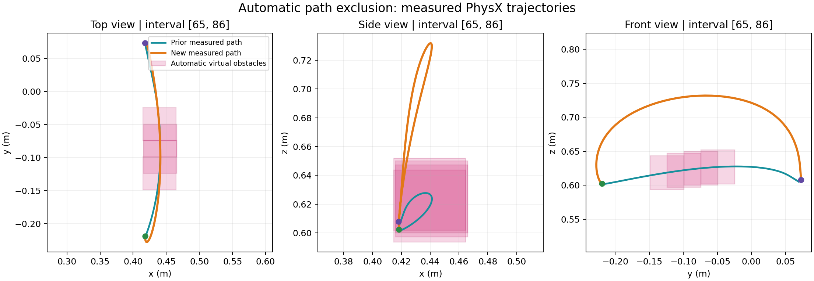

# multipath — Interaction-Anchored Trajectory Generation

**Semantic correction (2026-09-30):** direct inspection of the original
144-frame / 30-fps video shows a held-bowl tilt over the board, return to the
source location, and only then release. Earlier runs below used an incorrect
place-on-board terminal predicate and stretched execution to roughly 50 s.
They are historical physical/planning diagnostics, not valid reproductions
of the source action. The replacement `hpc/run_source_clock.pbs` produced a 4.8-second
hold/tilt/return/release rollout (`source_clock_r11`) passing current heuristic
checks, with remaining angle/position errors and imperfect repeatability.
See the [repair report](docs/SOURCE_CLOCK_REPAIR_REPORT_20260930.md).

**Source-clock diversity (2026-10-01):** reusable small–large–small virtual
obstacles, fixed-time route screening, and actual-path validation are implemented.
New-semantics multi-solution acceptance is still under validation; the old
place-on-board diversity result is not evidence for the corrected task.
See [implementation and current limits](docs/SOURCE_CLOCK_DIVERSITY.md).

**V0 (current work, floating XHand):** static oracle Interaction Anchors →
local padded human-to-XHand retarget → physical Replay / Cartesian MPPI /
small residual PPO → cuRobo wrist planning only in RELAXED intervals.
V0 uses no VLM or complete robot reference. The active local development entry
is `hpc/develop_floating_anchor.pbs` / `scripts/develop_floating_anchor.py`;
reviewed segmentation remains `configs/oracle/put_in.json`.

The floating controller applies external force/torque to the wrist and drives
finger joints. Objects move through PhysX contact. cuRobo uses a virtual six-DOF
wrist model with measured full-hand and carried-object collision geometry;
these virtual joints are not a physical robot arm. Source time is immutable.
Current integration starts with a physical bridge to the first synthesis window,
then padded Replay, MPPI/PPO if needed, and exported-core replay. This development
prefix does not yet establish the final bridge to the canonical core entry or
the complete 4.8 s rollout. Floating A1 remains under physical validation.

The mounted backend and its passed r10 bridge are preserved at
`hpc/run_oracle_v0.pbs`. Floating success will not constitute mounted-arm
reachability evidence. Multi-path remains deferred until continuous Oracle V0.

The old VLM/reference-event compilers, full-reference source-clock runners,
and path-exclusion implementation remain experimental/historical paths.

First target: `(put in, bowl, plate) / 20231024_253`.

The mounted entrypoint acquires each predecessor prefix, synthesizes the local padded
Anchor, verifies its exported core, and finally runs a fresh complete trajectory.
`--stop-before-anchor` obtains a prefix without executing an unvalidated core.
See [code audit and validation limits](docs/CODE_AUDIT_20261002.md).

Previous mounted oracle V0 result: the first 1.1667-second bridge passes real PhysX
handoff (0.00846 rad maximum joint error); Anchor synthesis is still pending.
See [progress and actual comparison video](docs/evidence/oracle_v0_20261002/REPORT.md).

**Historical physical diagnostic:** the mounted Franka + XHand Put-In runner completed
all five BC/cuRobo windows from the ready pose in continuous PhysX, with
zero handoff resets and a released, stable bowl inside the target footprint
(`mounted_pipeline_r25` and an identical-configuration repeat, `r26`).
This uses repaired, scene-specific BC commands;
automatic missing-BC synthesis remains unverified. A reusable path-obstacle
generator and serial search loop also produced a second physically successful
path (`mounted_diverse_auto_01/solution_02_attempt_01`): obstacles were placed
automatically along the measured curve, with entry/exit geometry protected.
See [physical results and run instructions](docs/MOUNTED_PIPELINE.md).



**Historical/experimental pipeline (not the Oracle V0 entrypoint):**

```
Single video + reconstructed digital twin
 -> VLM BC/relaxed schedule, checked against contact and task semantics
 -> missing BC demonstrations: EgoEngine chunks -> retarget -> replay/MPC/local RL
 -> BC around key interactions; cuRobo in every relaxed interval
 -> measured boundary compatibility and physical correction if necessary
 -> uninterrupted PhysX execution and functional task check
 -> serial cuRobo path diversity, accepting only full successful rollouts
```

## Implementation

Current Oracle V0 modules: `oracle_schedule.py`, `anchors/`,
`execution/floating_scene.py`, `anchors/floating.py`, `anchors/floating_search.py`,
`planning/floating.py`, and the preserved mounted executor modules. The standalone `multipath` CLI and two-Anchor
`orchestrator.py` below are historical adapters; run Oracle V0 through
`hpc/run_oracle_v0.pbs` or `scripts/run_oracle_v0.py`.

`src/multipath/schema.py`: anchored boundary schemas and safe artifact I/O.

`src/multipath/schedule.py`: checks the VLM BC/relaxed time table and lists
the BC demonstrations and relaxed cuRobo windows that remain to be executed.

`src/multipath/transitions.py`: canonical boundary and fixed-grasp
compatibility checks.

`src/multipath/planning/curobo.py`: actual documented
`MotionGen.plan_single_js` and `attach_external_objects_to_robot` calls,
including observed bowl pose, matching named joints, real collision geometry
and the exact canonical end-joint configuration.

`src/multipath/orchestrator.py`: historical two-Anchor adapter control
flow, measured transition checks, physical-correction hook and fail-closed
acceptance.

`scripts/run_mounted_bc_curobo.py`: live Isaac Sim schedule executor with a
physically mounted XHand, the existing Put-In BC, cuRobo free-space bridges,
contact approach/release adapters, grasp retention checks, and actual-state
recording. See [mounted pipeline instructions](docs/MOUNTED_PIPELINE.md).

`src/multipath/path_exclusion.py`: reusable arc-length obstacle placement for
any Nx3 curve, boundary protection, cumulative accepted-path exclusions, and
measured-path comparison. The geometry API has no task-specific frame IDs.

`scripts/explore_diverse_paths.py`: serially generate exclusions, execute the
full task, reject failed candidates, and accumulate successful new paths.
`hpc/run_diverse_paths.pbs` runs this loop in one interactive allocation.

`tests/` + GitHub Actions: offline, mock-physics protocol tests.

## Prerequisites to physically run

1. Choose an **actual matching** Isaac Sim robot and cuRobo YAML. The local
Franka scene and arm motion probe are recorded in
[`docs/HOPPER_FRANKA_PROBE.md`](docs/HOPPER_FRANKA_PROBE.md).
2. Import the VLM BC-window schedule and retain the previous XHand finger BC.
Mount that XHand on an arm and map its previous floating wrist poses to
reachable arm poses, retaining the same grasp/release hand actions.
3. Revalidate each BC window in coupled-arm physics, including its entry/exit
state. Use EgoEngine local MPC/RL only when that replay needs correction.
4. Run the mounted schedule executor with `hpc/run_mounted_pipeline.pbs` on
Hopper, or the explicit Python entry point documented above.
5. Verify the complete task predicate and actual-state trace/video. No
simulated task success has been claimed from CI or the Franka probes.

Detailed [BC/cuRobo pipeline](docs/BC_CUROBO_PIPELINE.md),
[integration contract](docs/INTEGRATION.md), and [V0 milestones](docs/V0_PLAN.md).

```bash
pip install -e '.[dev]'
pytest -q
python -m multipath --help
PYTHONPATH=src python scripts/inspect_bc_curobo_schedule.py \
  configs/put_in_bc_curobo_contact_checked.json
PYTHONPATH=src python scripts/prepare_egoengine_bc_windows.py \
  --schedule configs/put_in_bc_curobo_contact_checked.json \
  --egoengine-trajectory /path/to/trajectory_refined.npz \
  --output-dir outputs/putin_bc_bootstrap_contact_checked
```

References: [existing EgoEngine fork](https://github.com/wallacexuhanxiao/diversityverifier/tree/feat/egoengine-xhand-faithful)
(`098a28a5c9001eb6600897447132cea550e715fd`) and
[DexImit-Open](https://github.com/mujc2021/DexImit-Open)
(`c5749809fa425525a9bf7aa392dbb3f6268ae28f`).
