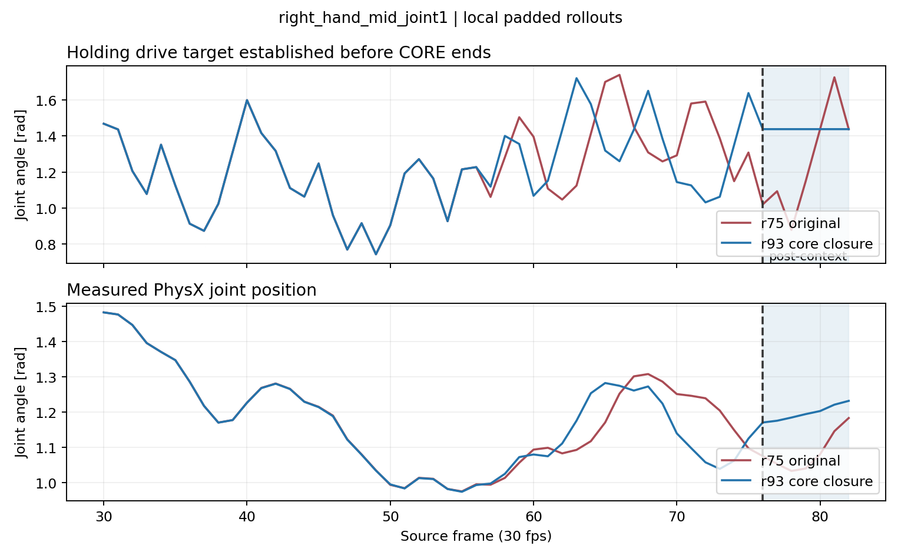
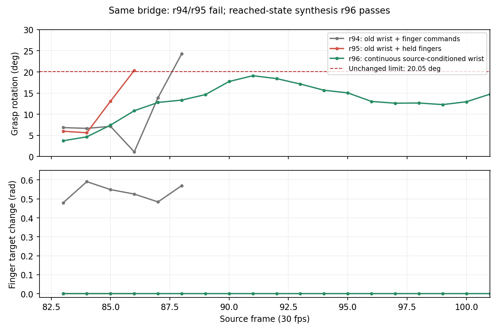

# A2 抓持失败：原因定位、修复与物理结果（2026-10-06）

最新结论：r96 已通过 A1 actual CORE exit → 0.2 s cuRobo bridge →
A2 CORE 的连续 PhysX 执行（source 76–101，共 0.833333 s），期间 reset
为 0，手指 drive 全程保持实际 A1 出口目标。失败主因是移植旧 A2
控制轨迹后 wrist 目标不连续；仅冻结手指不足以修复。A1 的 fresh
padded/core 已在 r93 通过，新 A2 CORE 在真实 bridge entry 下已通过。
本轮没有重新验证新 A2 完整 padded artifact，也没有完成从 task
initial 开始的 4.8 s 全轨迹。最新视频与证据见文末 r96 更新。

## 实测事件

r65 整段 PPO 的最佳评分候选在帧 95 失去拇指接触。
取得物理抓持时的 thumb bend drive target 为 1.233 rad。

| 源帧 | thumb bend 目标 | 实测角度 | 目标−实测 | 拇指接触力合计 |
|---|---:|---:|---:|---:|
| 94 | 1.077 rad | 1.021 rad | +0.056 rad | 28.94 N |
| 95 | 0.789 rad | 0.995 rad | −0.206 rad | 0 N |

帧 95 中指仍有约 4.21 N 接触，物体相对手的旋转偏差约 0.072 rad。
这次具体失败是拇指接触丢失，而不是物体已经完全掉下去。拇指弯曲
目标相对取得抓持时退了 0.444 rad，并在丢失接触的帧转为张开驱动。

代码问题：初始 retarget 有 preload 保护，MPC / PPO 残差只检查 URDF
范围与目标速度，能绕过保护，把承载手指主动张开。

## 修复与配对实验

同一保护实现接入 nominal、MPC、PPO 和失败提案投影；仅作用于要求
持续抓持的局部 Anchor，使用真实 native contact 标识承载手指。
取得/释放 Anchor 仍可改变抓持，非接触手指保留调整空间。

r66 / 648804 做了同一 wrist 控制的配对 Replay：位置、旋转、六维
feedforward 与 r65 refined controls 完全相同，仅投影手指目标。
29.23 秒完成，但仍失败于帧 91。拇指 drive target 已保持为 1.284 rad，
中指接触却丢失，剩余拇指接触约 0.17 N。相对旋转 0.447 rad。
因此“禁止拇指张开”并不能单独解决整个 A2，不能据此声称抓持修好。

该结果暴露了第二处代码错误：用 `command_q - actual_q` 的正负当作
关节闭合方向。中指 proximal joint 的 drive error 为负，但正方向
依然是 flexion；旧规则反而禁止它继续闭合。负误差来自接触位移，
不等于负方向能夹紧物体。

现在闭合方向取自 SPIDER XHand 的关节语义，保护承载手指的闭合目标，
允许继续屈曲；index abduction 不按闭合关节限制。这是 embodiment
元数据，不是样本/任务特例。没有 frame 95 分支，没有调整 source 时间、
30° 容忍度、摩擦、PD 增益或 drive effort。

r67 / 648806 在发现方向约束有误后取消，不作为完整物理结果。
r68 / 648809 使用修正方向重新执行完整 local synthesis，105.03 秒完成。
初始 Replay 虽通过入口，仍在帧 86 因 core 物体偏差失败；随后浮空
XHand MPPI 在 3 轮、192 个残差候选中找到 7 个成功候选，另有 1 个
measured-grasp 提案。选定控制经 fresh padded Replay 和独立的
exported-core 验收，均成功。本轮不需要 PPO；PPO 使用相同保护代码。

这不是同一条 wrist 轨迹仅改手指后就成功：r66 是这样的配对实验，
且失败；r68 还进行了物理 MPC 优化。因此可以确认两个代码缺陷已修，
以及修复后的合成流程能完成 A2，不能将全部收益单独归因于拇指保护。

相关 17 个快速检查通过（0.63 秒）；唯一新增回归针对已发生的残差绕过
承载指保护问题，覆盖闭合、继续屈曲、非接触指调整和 release。

## A2 物理验收

| 项目 | r68 实测结果 |
|---|---|
| padded synthesis | 源帧 [76,107)，31 帧 / 30 fps，1.033 秒，成功 |
| exported core | 源帧 [82,101)，19 帧 / 30 fps，0.633 秒，成功 |
| A2 入口目标 | TACO 源帧 82；不是 A1 出口 |
| 实测入口误差 | 3.42 cm / 18.03°，通过既有 5 cm / 30°条件 |
| 入口来源 | r58 真实帧 76 snapshot → 实际 padding → 实测帧 82 |
| core 边界 | 执行 padding 到达，没有在边界设置状态 |
| 抓持 | core 全程通过既有对向接触和相对变换保持检查 |
| core 入口接触 | 中指约 20.68 N、拇指约 19.55 N |
| core 出口接触 | 中指约 40.30 N、拇指约 44.50 N |
| rollout 内 reset | padded 0，core 验收 0 |
| 时间 | 30 fps；没有等待或延长 source 时间 |

snapshot restore 只发生在独立开发 rollout 的起点；这不是一次完整
initial→A1→bridge→A2 的连续验证。`entry_physically_reachable=true`
对应真实 predecessor 加 synthesis padding 的来源链，不代表 cuRobo
已经验证过同一入口。

修复结构不依赖当前 sequence、帧索引或 Put In 任务名；闭合方向是
XHand embodiment 元数据，保护由实测接触和 Anchor contact mode
决定。第二个 sequence 的迁移收益还没有实验验证。

## 当前连接边界

A1（r58）与 A2（r68）都有局部有效 artifact，但 canonical 边界
仍不满足现有 grasped bridge 接口：最大手指姿态差 0.237 rad，
超过该接口的 0.10 rad 预检查；drive target 最大差 0.488 rad。
当前 bridge 冻结抓持手指，无法直接产生新 A2 的这些 hand 边界。
手物相对变换的最大矩阵元素差 0.068，也超过既有 0.05 的交接检查；
对应实际相对位移约 5.98 mm、旋转约 4.31°。

两端 wrist 距离 13.26 cm、旋转差 49.33°，source bridge 预算仅
0.2 秒。这里是边界预检查，还没有执行该 cuRobo bridge；不能据此
宣称物理连接必然不可行。下一步需协调 canonical 抓持边界，再用
固定时间 cuRobo 和实际 rollout 验证；不允许直接设到 A2 entry。
完整初态前缀仍被 cuRobo canonical collision 检查拒绝，完整 4.8 秒
V0 尚未完成。

## 产物

- [A2 padded 实际 PhysX 视频](../outputs/oracle_floating_a2_closure_search_r68/anchor_1/refined_replay/floating_xhand_actual.mp4)
- [A2 core 实际 PhysX 视频](../outputs/oracle_floating_a2_closure_search_r68/anchor_1/exported_core/floating_xhand_actual.mp4)
- [机器报告](evidence/oracle_floating_20261006/r68_summary.json)
- [完整开发结果](evidence/oracle_floating_20261006/r68_result.json)
- [有效 A2 artifact](evidence/oracle_floating_20261006/r68_anchor_1/report.json)

视频按 source 帧率渲染记录的 PhysX mesh world transforms，已检查
31 帧和 19 帧视频可解码；不是 GT/reference 动画。105 秒是计算耗时，
不是机器人执行时长。视频在本地输出目录与 Hopper 结果目录，未纳入 Git。

## 后续：从局部 grasp 到 A1→cuRobo→A2

上述 r58→r68 canonical 边界不能直接连接。后续采用用户明确指定的
TACO 帧 82 物体边界条件，结合 A1 实测抓持变换，生成 wrist 目标；
不把 A1 出口当成 A2 入口，不沿人类轨迹逐帧约束 RELAXED。
目标提案不是物理 snapshot：只有实际 bridge 到达后，才能保存为
`physically_acquired_state=true` 的入口。已有 r68 A2 core 只作控制种子，
必须在新入口上重新执行。

### 已定位的连接问题及可复用修复

1. **局部成功不一定有可运输的出口。** r71 padded/core 均通过，但碗仍
   几乎被桌面支撑；cuRobo 的 carried-object 球代理穿入桌面 10.68 mm。
   给需要 grasped transport 的 local synthesis 增加同一碰撞代理的出口
   clearance 条件和出口速度条件。它只约束真实出口，不重新构造状态。
   r75 经物理 MPPI、fresh padded 和 core Replay 通过；其实际 core 出口
   距 table 43.76 mm、距 target 20.36 mm，速度比 0.213。
2. **旧 BC tracking error 被错误继承为新规划的全局碰撞膨胀。** r73 从
   实测状态出发，仍被上段 BC 的 127.34 mm 误差膨胀判为初态碰撞。
   新规划用实测起点和实测几何；旧误差保留为诊断。每个执行步继续
   检查实际手和 carried object 几何，不通过改碰撞阈值接受失败。
3. **原 oracle 目标本身在规划代理内碰撞。** r75 的 source-conditioned
   goal 球代理进入目标板 5.38 mm。用当前场景 signed distance 梯度修正
   目标提案，再检查原 5 cm / 30°边界和原时间预算。r76 修正后的目标
   仍仅偏离 source 9.01 mm / 13.61°，cuRobo 几何规划成功。
4. **移动边界不必沿同一几何路径切线。** r76 随后在时间拟合失败；
   旧标量 path-speed 参数化不能表达当前入口、出口的速度方向。
   commit `55243c6` 增加 endpoint-constrained geometric fit：固定两端
   q/dq，在原 physics ticks 内最小化对 cuRobo 路径的偏移，并硬约束
   命令速度/加速度。拟合后每个配置仍须通过 cuRobo collision 检查，
   然后接受连续 PhysX 验证；拟合成功不是物理成功。
5. **冷节点 native import 阻塞。** r69/r74 分别在 NumPy/Torch native
   import 超时，尚未进入 physics。这两轮不能算 interaction failure。
   加入原 native 文件预读并减少数学库线程；r75/r76 已进入实际运行。
   当前证据不单独证明预读是速度提升的唯一原因。

这些修复依赖实测状态、时间预算、碰撞几何与 grasp contact mode；没有
sequence/frame 特例，没有改摩擦、控制增益或源时间。第二个 sequence
尚未验证，不能声称已证明迁移收益。

### 精简实验记录

| 轮次 | 结果 | 提供的新信息 |
|---|---|---|
| r70 | core 帧 70–73 物体偏差失败 | 仅整形出口命令不足以保持 interaction |
| r71 | A1 local padded/core 成功 | 出口仍需支持于桌面，不能直接 transport |
| r72 | A2 padding 帧 79 grasp retention 失败 | 不再靠 BC 重做 RELAXED transport |
| r73 | 初态 world collision | 旧 tracking inflation 和真实低 clearance 两个原因 |
| r75 | A1 local 成功；bridge GRAPH_FAIL | 已有真正可运输出口，目标代理碰撞 |
| r76 | cuRobo 几何成功，时间拟合失败 | 移动边界切线条件不成立 |
| r77 | 规划与时间拟合通过，执行中 proxy collision 失败 | 固定时长可行；需区分代理碰撞与实际穿透 |
| r78 | 源帧 77.75 proxy collision | 真实碗表面未到达目标板，仍是代理的保守重叠 |
| r79 | 初始化退出 124，尚未 physics | 依赖预读被错误放在关键执行路径 |
| r80 | 源帧 79.25 retention 相对旋转超限 | 首次走过碰撞误判，接下来验证抓持假设 |

r77 job `649000.hopper-m-02`，r78 job `649022.hopper-m-02`，
r79 job `649038.hopper-m-02`，r80 job `649045.hopper-m-02`：
interactive / H200 / 20 分钟。
提交参数请求 32 GB，但 r78 PBS 记录的实际 resource request 为 225 GB；
应以调度器记录为准，而不能把提交参数当成实际分配。
只新增一个针对实际发生过的移动边界失败的快速 regression，连同原
边界检查共 2 个检查通过。当前真实边界的 CPU 必要动力学检查通过：
0.2 秒，命令速度比 0.615、命令加速度比 1.000；这不是物理验收。

本次 bridge 开发从 r75 真正 acquired 的帧 76 snapshot 恢复一次，
之后 bridge→A2 core 不允许 reset。它是源帧 76–101 的连续开发切片，
即使通过，也不等于完整 initial→4.8 秒 Oracle V0 已经通过。

r77 用时 40.85 秒；拟合后 command velocity ratio 0.627，acceleration
ratio 1.000，全部计划配置通过 cuRobo collision 检查。真实执行到源
帧 77 后，在下一次记录前发生代理碰撞；没有到帧 82，没有运行 A2。
录制的帧 77 碗表面到目标板 box 最近距离为 39.66 mm，而旧代理只剩
3.92 mm。这不是已证实的真实表面穿透。

根因之一是 `cover_points` 原来无条件填满 PCA 包围盒，空的格子也
生成球。commit `a0e6a4f` 改用三角面 bounding cells：每个三角面都
被保守 cell spheres 覆盖，空 cells 不再代表实体。没有减小球的覆盖
半径、没有关闭 collision gate。carried-object 代理在物体坐标系缓存，
由 planner、出口检查和每步实际验证共用，避免三处覆盖不同几何。
帧 77 同一碗的代理到 target 距离因此为 9.28 mm；是否足够完成真实
transport 必须看 r78。新增一个针对空体积被误填充的几何 regression，
连同边界检查共 3 个快速检查通过（0.52 秒）。

另外，A1 actual exit 的碗相对 wrist 速度仍有约 0.103 m/s、3.09 rad/s。
这作为潜在抓持滚动/滑动诊断记录；没有在无硬件依据下新增拒绝阈值。
若桥段再次失败，需根据精确失败步的 retention、表面距离和状态定位，
不能把代理修复直接当成 interaction 已解决。

r78 49.18 秒完成，首次代理失败精确在源帧 77.75：target clearance
-2.69 mm。但同一步的真实碗表面顶点离 target box 30.15 mm，离 table
53.55 mm；精确 triangle/box SAT 检查也没有相交。抓持相对变化为
10.13 mm / 0.199 rad，仍满足已有 retention 条件。

因此 `eeddeec` 保留规划层的保守球代理；执行层在代理重叠时，使用
实际 world mesh 做 triangle/box SAT，并对闭合物体补包含检查。真实
相交仍拒绝，代理重叠仅触发精确复核。没有改距离阈值或关闭碰撞。
检查结果逐步保存到 `proxy_overlap_refinements`，真实失败的实际状态
单独保存；不再只留下一个无法 attribution 的 collision 字符串。
这项修复适用于一般 mesh/box，没有任务名、样本或帧分支。

r79 在 hopper-27 预读 154 个 native 依赖时超时，PBS exit 124，wall time
187 秒，尚未生成 bridge log。此前预读作为性能优化，却因 shell
fail-fast 成了强制前置 gate，反而阻止真正仿真启动。`3b007d7` 把预读
改为 20 秒的可选优化；未完成则继续由原受监控 import 验证依赖。
增加每个文件的开始/完成日志，便于定位共享盘读取卡点。没有把依赖
执行迁到 noexec 临时目录，也没有取消真实 import 的 watchdog。

此外，development restore 后 INITIAL 的 USD visual transforms 可滞后
于 native PhysX 状态；bridge 视频改用执行后的 N 个 endpoint mesh
capture，对应相同 N 个 source-time interval，保持 30 fps。源帧 76
的原 stale visual capture 不作为物理初态碰撞证据；初态以 acquired
snapshot 的实际 object pose 为准。

## 本轮最终结果：r80

r80 / `649045.hopper-m-02` 在 hopper-17 真实执行，计算耗时 92.43 秒。
cuRobo 几何与固定时间拟合通过；命令速度比 0.627、加速度比 1.000。
6 个代理重叠步经实际 mesh/box 精确复核，均没有相交。

执行到源帧 79.25，已走 13 个 physics ticks / 0.10833 秒后停止：

- hand-object 相对位移 19.59 mm，未超过原 50 mm 条件；
- 相对旋转 0.35832 rad / 20.53°，超过原 0.35 rad / 20.05° 条件；
- 原生 PhysX 接触仍同时存在：中指约 11.94 N、拇指约 12.89 N；
- 未到源帧 82，所以 A2 core 尚未执行；没有生成新的有效 A2 artifact。

**不能把这个结果描述成碗掉了，或已经发生真实碰撞。** 当前失败是
既有“抓持相对变换近似保持”的条件；0.35 rad 是 project constraint，
不是硬件极限。此前 source object 的 30° 容忍度是另一项条件，未改动。
本轮保留原阈值，也不因为只差约 0.48° 就把结果改为通过。

下一项有信息价值的最小诊断是：保持失败标志，观察完整 0.2 秒末端的
actual contact、actual mesh collision 和 source 帧 82 物体边界。若实际
interaction 失败，再把真实 transport rollout 纳入局部 grasp 优化；
不先围绕 20.53°→20.05° 开新一轮阈值/平滑微调。本轮尚未跑这个诊断。

bridge 启动时只从 r75 acquired snapshot 恢复一次，执行中无 restore
调用；此项由保存的运行代码和实际 source clock 追溯。r80 原报告未
输出 restore counter，已在 runner finally 补上以便后续直接记录。
机器 summary 将这项明确标作 code-derived，不冒充当轮计数测量。

**当前验收状态：A1/A2 局部有效；A1→cuRobo→A2 尚未通过；完整 4.8 秒
Oracle V0 未完成；没有开展 multi-path。** 所有修改都是一般边界速度、
mesh 几何和运行机制，没有样本/任务名分支。迁移到第二个 sequence
仍未验证。

产物：

- [r80 机器结果](evidence/oracle_floating_20261006/bridge/r80_result.json)
- [r80 summary](evidence/oracle_floating_20261006/bridge/r80_summary.json)
- [r80 actual trace](evidence/oracle_floating_20261006/bridge/r80_actual_trace.json)
- [r80 首次失败的实际状态](evidence/oracle_floating_20261006/bridge/r80_failed_actual_state.json)
- [r80 失败桥段视频](../outputs/oracle_bridge_physics_r80/bridge/floating_xhand_actual.mp4)
- [r75 有效 A1 padded 视频](../outputs/oracle_carry_exit_bridge_r75/anchor_0/refined_replay/floating_xhand_actual.mp4)

r80 视频是 3 个执行后的实际 mesh capture，30 fps / 0.1 秒，已验证
可解码；是停止前的短片，不是完成了 0.2 秒的 bridge。它与 r75 的
53 帧 / 1.7667 秒局部 A1 视频分开，不拼接成一次 uninterrupted rollout。

证据目录：[bridge 实验报告](evidence/oracle_floating_20261006/bridge/)。

## Bridge 接管诊断与修复：r81–r86

A2 r68 的局部 padded/core 成功仍有效。以下实验针对 r75 A1 实测出口
到 TACO 帧 82 的 0.2 秒 RELAXED bridge；这些失败均发生在 A2 core 之前。
不把 A1 出口当成 A2 入口，不修改 source 边界 5 cm / 30°，也不延长时间。

| 实验 | 方法 | 最大抓持相对角 | 帧 82 物体位置误差 | 结果 |
| --- | --- | --- | --- | --- |
| r81 baseline | 原 cuRobo path + PD | 25.15° | 50.43 mm | 抓持条件失败 |
| r81 continuous | 同一路径，保持接管初始受力并衰减 | 14.89° | 75.76 mm | 抓持保持，终点失败 |
| r81 old drive | 保持旧 drive，仅作对照 | 12.48° | 112.02 mm | 抓持保持，不是成功的 bridge |
| r82 torque only | 只连续 torque | 20.99° | 未完成 | 拇指/其他手指对向接触丢失 |
| r82 force only | 只连续 force | 15.46° | 71.10 mm | 抓持保持，终点失败 |
| r83 balanced | 线性 PD 模型下末端影响为零的 force profile | 20.14° | 60.36 mm | 两项均失败 |
| r85 gravity + cubic | 实测碗重力补偿 + 连续接管 | 14.59° | 76.84 mm | 终点失败 |
| r85 gravity + balanced | 实测碗重力补偿 + balanced profile | 30.29° | 68.25 mm | 两项均失败 |
| r86 feedback goal | 实测 r81 终点反馈，重新拟合一个 canonical goal | 21.24°（停止时） | 未到 82 | 帧 81.25 抓持条件失败 |

r81 的 threshold failure 在继续诊断到 82 后仍标作失败，不冒充有效
rollout。各 trial 只在开始时恢复同一 physically acquired snapshot，
执行内部无 reset。r84 是 native COM 返回形状处理错误，未产生新物理
证据；修复后 r85 正常运行。以上补偿试验均未提升为默认行为。

明确的 attribution：同一规划路径、同一入口下，保留初始 drive response
能消除 r80 的抓持相对角失败，因此不能把失败直接归咎为 A1 的碗根本
抓不住。但接管补偿本身改变闭环运动，仍无法同时满足终点条件。
r86 的静态终点偏差模型也不能预测更换路径后的动态抓持响应。

新的执行修复使用实际 PhysX 中手和碗的质量、COM、惯量，对规划的
线速度/角速度差分计算 Newton–Euler feedforward。此前只有 PD 和手重力，
缺少所规划加速度对应的负载受力/力矩。此模型只生成控制输入，最终
仍由实际 contact、抓持相对变换、mesh collision 和 source 终点验收。
没有增加人工等待、reference 中间状态或 RELAXED 人体轨迹相似度条件。

同时保存和恢复 `controller_wrench_bias`，使 PhysX snapshot 的控制器
状态与实际驱动一致；桥到 core 的接管可在 core 原有时间中保持初始
受力并衰减。原 Anchor replay 默认保持旧行为。代码无任务名或帧分支；
迁移效果尚未以第二个 sequence 验证。

r87 / `649924.hopper-m-02` 已执行，同一路径下：

- 单独 dynamics：帧 81.25 手腕位置误差 4.01 mm、角误差 2.25°，
  但抓持相对角达到 20.93°，并丢失非拇指接触；未完成 bridge。
- dynamics + 全时长连续接管：完成 0.2 秒，抓持相对角最大 15.81°、
  位移最大 16.92 mm，对向接触保留；source 终点误差 80.84 mm，失败。

实测总质量 1.372385 kg（XHand 1.122385 kg，碗 0.25 kg）。这说明
动力学补偿可以改善 wrist tracking，但 tracking 成功不是 grasp 成功。
不能把 4 mm 的 wrist error 单独当作可执行 bridge 证据。

r88 / `649931.hopper-m-02` 使用 dynamics + balanced force，完成 0.2 秒，
但最大抓持相对角 30.79°、source 终点位置误差 71.24 mm，仍失败。
线性末端平衡 profile 未解决实际耦合抓持，保留为实验路径。

r89 / `649934.hopper-m-02` 检验按质量、惯量、控制增益计算的接管衰减
时间；不再把整个 bridge duration 直接当 controller 的响应时间。
两者概念不同：source budget 固定，controller 的 drive memory 应在
自身响应尺度上衰减。实际完成 0.2 秒，但抓持相对角最大 27.09°，
source 位置误差 57.95 mm，失败；没有提升为默认 controller。

此外，新的 A2 core seed 按实测抓持坐标变换：
`T_w_new = T_w_old @ H_old @ inv(H_reached)`，保留局部 interaction 的
隐含 tool target。速度由原命令及坐标偏置的运动变换，不能从旧入口
drive target 与首帧位置之差重算，否则会凭空引入第一步速度尖峰。
此 seed 必须从 bridge 的真实出口无 reset 执行，并通过 core 验收。

## 真正需要修的 Anchor 边界：手指闭合尚依赖 post-padding

r90 / `649985.hopper-m-02` 使用单一 quiet canonical 提案：终点速度为零，
仍满足原 5 cm / 30° source 条件。CPU 提案位置误差约 0，角误差 29.4°；
cuRobo 后真实执行 0.2 秒，相对抓持角 36.47°、source 位置误差 60.04 mm，
失败。因此继续微调 controller profile 或目标提案不足以解决该边界。

重新检查 A1 的实际 padded rollout 后发现：

- core 结束帧 76 到 post-padding 结束帧 82，hand drive target 最大仍
  变化 **0.417403 rad**。RELAXED 却从 core 结束立刻冻结这个目标。
- 帧 76 wrist 角速度为 `[-0.1148, 0.1221, 0.6423] rad/s`，碗角速度为
  `[-2.8355, -0.2453, 2.0605] rad/s`，相对角速度模长约 **3.09 rad/s**。
- A1 padded 成功没有证明 exported core 的握持已经稳定到可以冻结
  hand command 并 transport。旧 bridge 的 rigid-carry 模型在入口就
  面对一个仍在旋转/闭合的真实 grasp。

`carry_boundary_commands` 将后文 context 的 holding drive posture
在 core 结束前建立，并在 post-padding 冻结该目标。只重新安排局部
finger command，wrist command 和 source clock 不变；手指位置/速度
约束仍通过原投影，无法在 core 内建立则拒绝。时间范围由 Anchor 的
pre/post context 定义，没有 sample、task、frame 特例。

r91 / `649999.hopper-m-02` 从 r75 真实 acquired synth_start snapshot 开始，
重新执行 A1 padded 与 exported core。只有二者成功，才自动接新的
A1 actual exit → cuRobo → A2 core。该 proposal 尚待物理结果；不能把
提前闭合的命令可行性说成新 grasp 已有效。

actual-state 视频：[r87 保持抓持但终点失败的 bridge](evidence/oracle_floating_20261006/bridge/r87_actual.mp4)，
6 帧 / 30 fps / 0.2 秒，已验证可解码。只展示对应 trial 的连续物理状态。

r91 在物理 rollout 前被手指 nominal fit 拒绝。原因是仅做 forward
slew clipping，会把压缩后的最后几步闭合又推迟到 padding。已补充
从 holding terminal posture 向前传播的速度 envelope，保留真正的
terminal condition；joint speed/bounds 未放宽。r92 / `650018.hopper-m-02`
重跑 fresh padded/core，二者成功后才进入新的 bridge。

r92 未进入 physics：hopper-27 的 `scipy.linalg.blas` native module
加载卡住，120 秒 watchdog 输出调用栈后退出。保存
[原始超时栈](evidence/oracle_floating_20261006/bridge/r92_import_timeout.log)；
此结果不归入 grasp failure。r93 / `650028.hopper-m-02` 在此前成功
加载过依赖的 hopper-20 排 interactive H200，申请 10 分钟，待运行。

GPU 排队期间，使用相同 URDF joint limits 做了此次 fit 的 CPU 检查：
nominal speed ratio 1.000000，joint bounds 通过，core 结束后的 hand
drive target 变化为 0。此项仅证明命令拟合，不能代替 padded/core 或
bridge 的物理结果。

**r92 时状态：旧 A1/A2 的 local artifacts 仍有效；中间 bridge 未
通过；新 A1 grasp-boundary 修复已提交 fresh 物理验证。完整 4.8 秒
V0 尚未成立。** 所有 failed trials 和 experimental controller 配置
保留失败标记，未改成默认成功路径，也未放宽 acceptance。

## 更新：r93 的 A1 与 bridge 实测通过

r93 / `650028.hopper-m-02` 在 hopper-20 完成，PBS 总 wall time 80 秒。
新 A1 的 padded Replay 与从实际 padding 到达入口后的 exported core
Replay 均成功，内部 reset 均为 0。原 wrist command 保留，holding finger
drive 在 core 结束前建立，之后保持不变。

从新 A1 的真实 frame 76 core exit 恢复一次，再连续执行 cuRobo bridge
及 A2 core proposal。bridge 的结果为：

| 项目 | r93 实测/检查 |
| --- | --- |
| source interval / 实际 bridge 时长 | 76–82 / 0.2 s |
| source 帧 82 物体位置误差 | 18.026 mm，原阈值 50 mm |
| source 帧 82 物体角误差 | 11.2656°，原阈值 30° |
| 原生 contact | thumb AND non-thumb，保留 grasped |
| persistent grasp 检查 | 每个 120 Hz step 通过原 50 mm / 0.35 rad 条件 |
| 30 fps 记录中的最大 grasp 相对位移 / 角 | 16.249 mm / 12.574°；不是 120 Hz 峰值 |
| command velocity / acceleration ratio | 0.7611 / 1.0000，原 nominal budget |
| 手指 drive target | bridge 内冻结 |
| 执行中 state reset | 0，包括随后 A2 proposal |
| actual mesh collision | 原执行 gate 未触发真实相交 |
| 完整 robot reference / VLM / 时间伸长 | 均未使用 |

注意：cuRobo raw path 无法直接压缩到 0.2 秒，由已有 boundary-constrained
fit 在同一预算中生成可行 commands，每个拟合后的配置重新通过 cuRobo
collision check。不是把超预算 raw path 当成成功。carried-object 和当前
XHand 几何均参与规划；验证 scope 是 floating XHand，非 mounted arm。

这证明新的握持边界与执行接口可以到达 oracle frame 82 条件。不能
把成功完全归因于一个 controller 参数：finger closure 改变了实际
predecessor，planner 基于该真实状态重新规划。出口相对角速度仍有
2.888 rad/s，因此未宣称该诊断量消失；实际 bridge retention 成功才
是验收证据。第二个 sequence 的迁移尚未验证。

### A2 新入口兼容性仍失败

旧 r68 A2 core 经 grasp-frame adaptation，从实际 frame 82 直接继续
执行，在 frame 86 被 `core_object_fidelity` 拒绝：物体位置误差
58.931 mm > 50 mm，角误差 19.50°；此时 grasp 保留，相对角 13.63°。
不是碗掉了，也不是旧 r68 local artifact 被判无效。

PBS exit 1 来自 `next_core_success=false`；机器报告同时明确
`bridge_success=true`。源码未把整段 pipeline 标成成功。
当前 core 接管补偿按整个 0.633 s core 衰减，较大的初始 drive bias
持续过久可能影响 source tracking。r94 / `650050.hopper-m-02` 在已成功
的 A1 出口上，检验同一 mass/inertia/gain response-scale 接管；不改
core reference、source clock 或物理阈值。尚待此物理结果。

产物：

- [新 A1 actual-state 视频](evidence/oracle_floating_20261006/bridge/r93_a1_actual.mp4)：53 帧 / 1.7667 s，local padded rollout。
- [成功 bridge actual-state 视频](evidence/oracle_floating_20261006/bridge/r93_bridge_actual.mp4)：6 帧 / 0.2 s。
- [A1 报告](evidence/oracle_floating_20261006/bridge/r93_a1_result.json)、[bridge + A2 proposal 报告](evidence/oracle_floating_20261006/bridge/r93_bridge_result.json)、[真实到达的帧 82 状态](evidence/oracle_floating_20261006/bridge/r93_reached_entry.json)。

图中上行为记录的 drive target，下行为 PhysX 实测关节位置，均为
30 fps 采样的独立 local padded rollout。实测关节可继续因接触而变化，
修复要求的是 holding drive 在 core 出口建立，不是直接锁定物理关节。

**最新状态：A1 局部有效；A1 actual exit → source 帧 82 cuRobo bridge
已物理通过；从该新入口执行 A2 仍需修复。完整 4.8 s initial-state
Oracle V0 未完成。** 上述 A1 视频与 bridge 是独立 development rollout，
没有拼成一次从 task initial 开始的 uninterrupted rollout。

## 更新：r94–r96，A2 CORE 不能直接移植旧抓姿的控制补偿

r94 / `650050.hopper-m-02` 的 bridge 再次成功，A2 在 source frame 88
被 `core_grasp_retention` 拒绝。此时 native thumb AND non-thumb contact
仍存在；物体相对实际入口手姿旋转 24.27°，超过原 0.35 rad（20.05°）
保持抓持约束。不能把该结果简单描述为碗已经掉下去。

实际入口与旧 r68 A2 的 finger drive 不同，旧 core 的 finger commands
也随 source frame 明显变化。r95 / `650110.hopper-m-02` 仅将 persistent
carry 的 finger proposal 改为真实入口 holding drive，重新执行同一
bridge 与同一 wrist commands，仍在 frame 86 失败。对照证明：冻结
手指是接口要求，但单独这样做不足以解决 interaction failure。

更直接的接口问题：移植后的第一个 wrist target 相对 bridge 末端
记录的 drive target 跳变 **52.196 mm / 25.935°**。旧局部优化得到的
wrist targets 包含旧 grasp、旧动态状态下的 tracking compensation。
仅做 hand-object transform rebase 会保留这些偏置。原 takeover bias
只抵消第一步的 drive wrench，随后衰减仍暴露不连续的目标；它不能
代替位置/速度边界连续性。

可复用修复：对于持续抓持的 Anchor，从局部 source object poses 与
真实 reached hand-object transform 重新生成 Replay proposal；finger
baseline 沿用 reached holding drive；使用已有 measured-grasp target
handoff，在原 core 时间内连续衔接上一段 wrist position / velocity
commands。取得/释放 Anchor 仍保留交互动作，CORE 首个 finger drive
先与真实 predecessor 一致。没有 sample 名称或 source 帧特例。

r96 / `650136.hopper-m-02` 验证 fresh source-conditioned Replay。
本条 core 为 76 个 120 Hz ticks（0.633333 s），handoff 持续时间由
目标差与共享 wrist velocity budget 得出 0.094109 s；它在 CORE 内
执行，既不是等待，也没有增加 source time。CPU 检查确认位置边界
（按刚体变换比较，避免 quaternion 正负号等价造成误判）、首个 twist
与 predecessor 一致，所有 finger commands 保持 acquired preload。
一个针对该已发生失效的 regression 直接运行通过；本地未安装
pytest，未宣称 pytest suite 通过。syntax / diff 检查通过。

r96 的实际结果见下一节。r94/r95 原始机器报告与逐帧 attribution
已保存，失败状态未改写。

### r96 结果：bridge → A2 CORE 连续通过

r96 / `650136.hopper-m-02` 在 hopper-20 完成，PBS wall time 55 s，
exit status 0。机器状态为 `bridge_and_core_valid`，bridge / next core
均为 success；A2 实际执行到 source frame 101。开发起点为 r93 A1
真实 CORE exit snapshot，恢复一次后不中断执行 bridge 和 A2，
段间 reset 为 0；这不是从任务初态开始的完整 rollout。

| 项目 | r96 |
| --- | --- |
| bridge / A2 CORE source interval | 76–82 / 82–101 |
| source 时间 / 实际执行时间 | 0.2 + 0.633333 = 0.833333 s / 相同 |
| 与 r94/r95 bridge commands | 完全相同，逐元素核对 |
| bridge 与 A2 的 finger drive 变化 | 0 rad |
| A2 每个源帧 native contact | 保留 thumb AND non-thumb |
| A2 源帧采样最大物体位置误差 | 47.826 mm，原阈值 50 mm |
| A2 源帧采样最大物体角误差 | 26.462°，原阈值 30° |
| A2 最大 hand-object 相对位移 / 角 | 15.165 mm / 19.101°，原阈值 50 mm / 20.054° |
| 新增等待 / 时间伸长 / 段间 reset | 0 / 0 / 0 |

A2 的上述峰值来自 30 fps 实测记录与验收，不冒充 120 Hz 峰值。
RELAXED bridge 使用既有每个 physics step retention 检查；本轮保持
原 cuRobo、carried geometry 和碰撞检查。没有 VLM、完整 robot
reference、新 MPC/RL、碰撞/接触阈值放宽或 sample 特例。

因果对照：r95 已保持相同手指 target，仍失败；r96 保留相同实际
入口、bridge、手指 target、controller handoff 与 acceptance，改为
从实际 drive 边界重新合成 source-conditioned wrist commands 后
通过。这支持“旧 grasp 控制补偿移植到新入口”的问题定位，不能
简化成“冻结手指就够了”。该方法没有 task/sample/frame 分支；
尚未用第二个 sequence 验证迁移。

报告字段也做了小修复：过去 core-only 的 `padded_rollout_complete`
只是“本次命令跑完”，容易误读。源码现在分为 `rollout_complete`、
`core_rollout_complete` 和真正的 `padded_rollout_complete`。r96 原始
报告保留原样，摘要明确这次只有新 CORE 验证，未凭此生成一个
声称新 padded synthesis 已验证的 canonical artifact。

产物：

- [连续 bridge → A2 actual-state 视频](evidence/oracle_floating_20261006/bridge/r96_bridge_a2_actual.mp4)：25 帧 / 30 fps / 0.833333 s，来自同一次不中断 PhysX 执行；没有插值补帧或重置。
- [机器摘要](evidence/oracle_floating_20261006/bridge/r96_core_summary.json)、[原始结果](evidence/oracle_floating_20261006/bridge/r96_bridge_result.json)。
- [r94 attribution](evidence/oracle_floating_20261006/bridge/r94_core_attribution.json)、[固定手指对照 r95](evidence/oracle_floating_20261006/bridge/r95_core_attribution.json)。

远端原始输出：`/scratch/e0985859/multipath_v0_fc2da7b/outputs/oracle_v0_650136`。
本地实际 trace、mesh records、commands 及运行源码 snapshot 位于同名
`outputs/oracle_v0_650136/`。本轮已经修复并验证 bridge → A2 CORE；
完整 4.8 s Oracle V0 与新 A2 padded canonical artifact 仍需后续完成。
