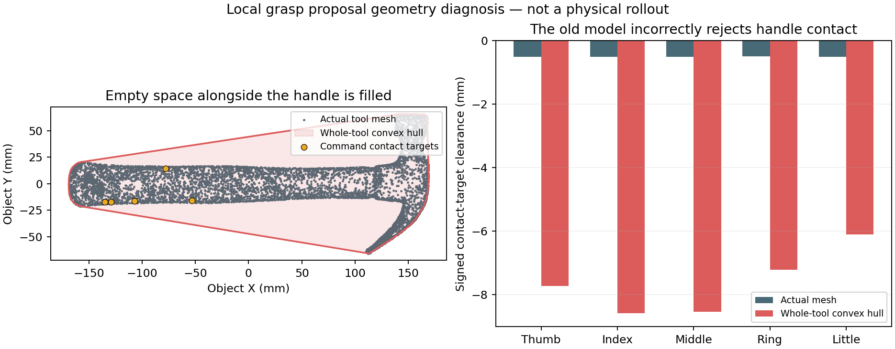

# 不同 TACO 动作类型的端到端验证

目标：同一默认入口处理不同动作类型；每个 RELAXED 区间三解，
每条解都从任务初态进行完整连续 PhysX 验证。使用静态人工 Oracle，
只 retarget/synthesize padded Anchor，保留原始 source clock。

## 本轮输入

| 类型 | TACO source | 源时间 | 交互证据 |
|---|---|---:|---|
| 倒碗 | `(pour in some, bowl, plate)/20231024_246` | 145 / 30 = 4.833 s | native 抓握、持碗倾斜、返回释放；无液体模型 |
| 擦盘 | `(brush, eraser, plate)/20231103_057` | 110 / 30 = 3.667 s | native 抓握及 eraser/plate 实际接触；无清洁外观模型 |
| 锤击 | `(hit, hammer, box)/20231102_003` | 170 / 30 = 5.667 s | native 抓握及 hammer/box 实际接触；无破坏模型 |

Oracle 来自本轮原始 RGB 的人工逐帧检查。配置只保存输入身份、
区间及必要交互条件；三者使用相同 controller、规划预算和小型 PPO。
没有动作名称或 source ID 的运行时控制分支。
当前执行右侧 floating XHand；左手对 target 的动作未复现。

## 真实失败及通用修复

1. **短暂接触被用作局部库的抓握终点。** r171 pour 的首个 core
   有 opposition contact，但工具仍受桌面支撑，随后的 carry bridge
   不能离开碰撞边界。局部库迁移现只选择已验证的 canonical CORE
   exit，不再按人类姿态相似度截取较早的短暂接触。
2. **free bridge 缺少完整动力学前馈。** r171/r172 brush 在 Anchor
   前出现拇指/工具真实 mesh 交叠。新增 free-motion Newton–Euler 前馈，沿用
   measured-state 连续 takeover；已通过的旧 bridge 保留其原执行
   语义。前馈标记随 bridge artifact、局部前驱重执行和多解传递。
3. **规划只覆盖入口手姿。** free bridge 在准备 pregrasp 时改变手指
   驱动。现用 URDF FK 覆盖这些手姿的几何，仍逐 physics step 检查
   actual mesh；不改 PhysX 状态来计算规划几何。
4. **缩放 MANO 指尖没有落在细柄抓握表面。** r171 hammer 实测只有
   非拇指接触，未形成对握；原 retarget 指尖距工具 18–37 mm。
   增加 local object-aware grasp 初始化：按工具 mesh 截面及局部
   human grasp 求 XHand 实际接触面 IK，覆盖完整手几何。只拟合
   dummy 指尖曾把 distal phalanges 放进工具，现直接拟合接触三角面。
   它只产生 proposal，
   不能直接被标为 physically valid；仍走 Replay/MPC/PPO 与 fresh
   padded/core 验证。
5. **出口抬升不能靠最后一帧猛补。** r172 pour 的持续对握到 frame 49
   才出现，frame 50 前不足以抬离桌面；实际出口速度失败。抬升
   proposal 现在检查剩余原时间中的 nominal v/a 可行性。时间不足
   就要求重新合成抓握，不能加等待、拉长时钟或设置物体状态。
6. **姿态接近不等于接触交互。** brush/hit 的 Oracle 明确要求 core
   内工具/目标发生真实接触；记录每个 physics step 的接触次数和
   impulse，避免漏掉短暂锤击。padding 或 bridge 接触不代替 core
   证据。
7. **准备手型的闭合距离超过原时间预算。** r176 brush 的部分关节
   需要闭合 1.145 rad。实测 brush/hit 工具几乎没动，但参考已在
   抬升：brush frame 30 参考位移约 70 mm，实际约 1 mm；hit frame
   35 参考约 60 mm，实际不足 1 mm。不能把这两类失败描述成侧推。
   r179 使用相同几何目标，求最近的无接触准备手型，并按 Oracle
   fps、CORE 长度、URDF 关节速度计算闭合行程边界。brush 本地
   proposal 的最大关节行程降至 0.0745 rad，表面几何覆盖的最小
   准备间距约 2 mm。这只是名义可执行性，尚待 PhysX 验证。
8. **静态自由入口误用了移动中的 drive target。** 复用库 frame 35
   的自由手实际无接触，但 drive target 相对实测腕部低约 42 mm。
   这是运动跟踪滞后，不能当作静态 grasp preload。r179 将自由
   入口改为该帧的实测腕姿和手姿，CORE 内保留已有抓握 drive。
   迁移后的入口仍须由实际 cuRobo 执行到达，不能复制旧验证标记。
9. **只细化规划起点的碰撞球，改变了终点的抓握准备姿态。** r179
   brush/hit 名义准备手型到闭手的腕部行程仅约 0.7 / 5 mm，但
   真实 bridge 入口分别被抬高 38.7 / 40.2 mm。碰撞边界投影
   导致 CORE 用时先下探。r180 针对已经实际
   出现的失败，将完整手指 sweep 的表面覆盖同时细化到起点和
   终点。真实 mesh 若交叠则仍保留正常的边界投影；不缩小覆盖、
   不移除障碍物、不放松物理 gate。
   **r180 否定了“只需细化粗球”的判断**：完整 mesh 检查拒绝了
   原来的准备姿态，因此保守覆盖保持原样，入口偏移也仍在。
   进一步修正的是 retarget 的碰撞初始化：之前仅有每 link 32
   个点和局部截断的工具 hull，会遗漏指节面穿过工具及工具的
   其余部分。改为完整三角面的保守球覆盖和全工具支撑 hull。
   高密度扫描生成的 2422 个近重复支撑面降至最多 80 个，删除
   约束只扩大外 hull，不删除工具实体。实际 PhysX 验证仍必需。
10. **接触波动和逐帧 grasp frame 更新让接管目标跳动。** r179 brush
    frame 24 已有对握，但 frame 26–29 腕部目标仍往返，下一个
    velocity target 曾达到 -0.91 m/s。r180 保留首次持续 native
    opposition 取得的实际 hand-object transform，避免逐帧把腕部
    tracking lag 写进新目标；单个 physics step 的接触波动不重启
    handoff。实际接触和 retention gate 继续直接读取 native state。

闭手加入 URDF 速度内的手指 drive velocity feedforward；目标接管
和 MPC/PPO 使用同一个实测工具相对的 acquisition controller。
接触丢失时清除已获取 grasp 的缓存。均没有更改工具物理状态。

这些是几何、控制或局部库复用的共用机制。IK 几何误差、planner
success、partial rollout 都不是完整 pipeline success。

## 物理实验

- r171：H200 / interactive / 20 min，job 653975；三类型并行。
- r172：H200 / interactive / 20 min，job 653985；修复后重跑 pour/brush。
- r173：job 653997，细柄 proposal 改进，仍未形成物理有效 Anchor。
- r174：job 654015，自由 bridge 可执行，但三类型首个 Anchor 仍失败。
- r175：job 654078，完整手表面 IK / 实测工具坐标注册，首个 Anchor 仍失败。
- r176：job 654092，手指速度前馈；实测区分侧推与未及时抬升。
- r177：job 654113，brush/hit 暴露 trimesh 只读三角数组问题，已改为
  writable copy；pour 物理抓取仍失败。
- r178：job 655035，真实三角接触面 IK；brush/hit 对握更早出现，
  但源抬升时仍不足以负载。三类型均未通过。
- r179：job 655067，最近自由准备手型 + 正确静态自由入口；三类型
  仍未通过，总用时 430.46 s；暴露规划终点抬高与接管目标跳动。
- r180：job 655088，双边界完整表面覆盖 + 固定实测 grasp frame；
  三类型均未通过，总用时 430.80 s；定位到名义准备姿态的完整
  mesh 交叠，而非可以直接细化掉的粗球误报。

以上作业均使用 H200 / interactive / 20 min；三个 source 在一份
allocation 内并行运行。未更改 unrelated held job。

截至 r199，新三类型没有完整成功轨迹，也没有已验证的新 Anchor。
已有 put-in 248/243 的完整三解不能代替本轮跨动作类型的证据。
保持 `success=false`；partial actual-state 视频不是成功结果。

最终结果、实际视频与每个区间的多解指标在物理运行结束后追加。

## 2026-10-09：初始化与工具几何修复

### 已定位的原因

- r181 pour 的 20 分钟消耗在 cuRobo 构造阶段。r182 的真实调用栈
  落在 `_create_self_collision_thread_data`：完整 hand surface 细化后
  上万球都位于一个虚拟 wrist link，自碰撞球对全部已忽略，代码仍
  执行 Python 的平方数量球对循环。新增精确空集合返回；非空集合
  继续调用原函数。环境、完整手和 carried-object 碰撞几何保留。
- goal sphere cover 按零间距细化，boundary projection 却要求
  100 µm，造成合法准备姿态反复投影。现在 cover 和投影使用同一个
  100 µm 条件。r183 三个 source 都进入首个 Anchor；brush 的首次
  起点拒绝后重新规划成功，尚不能将它解释成已查清的数值原因。
- r183 的 hammer 只有拇指接触，未形成对握。对局部 command
  的工具接触目标做几何检查：距实际 mesh 表面约 0.5 mm，但位于
  全工具凸包内部 6.1–8.6 mm。锤头和柄的整体凸包填掉了抓握所需
  空处。这个模型会阻止手指靠近真实柄表面，不能用更大的 PPO
  网络解决。改用完整非凸工具 mesh 的局部 signed-distance field；
  1 mm 网格在接触附近直接采样原 mesh 的距离，只用于 proposal。
  最终有效性仍取决于 native PhysX padded/core rollout。
- 重拟合曾把已经固定在 entry-tool frame 的 proposal，当作随源
  物体运动的 human reference，混入未来抬升位移。新 proposal 保存
  `raw_wrist_hand_q`；旧 proposal 先恢复正确工具坐标，再拟合。
- 局部库的最后一个零接触状态不一定能成为新场景的自由规划入口。
  现在首个 bridge 拒绝时按顺序尝试库内更早的真实零接触边界；
  用尽后才回到 raw local retarget。库 proposal 已进入 Anchor 后，
  保留它作为 Replay/MPC/PPO 初始化，不因失败直接丢弃。

### 实验记录

| Run | PBS job | 申请时间 | 结果 |
|---|---|---:|---|
| r181 | 655112 | 20 min | pour 构造阶段超时；brush/hit 首个 Anchor 失败 |
| r182 | 655133 | 25 min | 856.99 s；定位空球对循环及 goal cover 不一致；三类均未完成 |
| r183 | 655164 | 25 min | 399.85 s；三类均进入首个 Anchor，局部 Replay/MPC/PPO 均未通过 |
| r184 | 655192 | 20 min | brush/hit 暴露缺少 `rtree`；pour 局部优化仍失败 |
| r185 | 655214 | 20 min | 库内较早自由入口可达；pour/hit 局部交互失败，brush 遇 TorchScript CUDA kernel 错误 |
| r186 | 655250 | 20 min | 444.99 s；brush 首个 bridge 遇非法 CUDA 内存访问，pour/hit 首个 Anchor 仍未通过 |
| r187 | 655730 | 20 min | 196.06 s；新几何核对错误使用 `robot_spheres` 字段，三个 case 在初始 bridge 前停止 |
| r188 | 655735 | 20 min | 441.84 s；核对方法作用域错误已修正；pour 首个 bridge 成功，局部 Anchor 优化失败 |
| r189 | 655737 | 20 min | 419.82 s；三个 source 的首个 bridge 均实际通过；CUDA 地址修复验证成功，三个首个 Anchor 的 Replay/MPC/PPO 仍失败 |

依赖新增 `.[retarget]`，避免新环境再次缺少 mesh proximity 所需的
R-tree。没有修改 Oracle 区间、时长、接触验收或 CORE 误差阈值。
本节代码修复均按几何、接触模式或实际失败驱动，没有动作名称 /
sample ID 的控制分支。仍需新的物理成功结果才能宣布新类型跑通。

### r186 使用的进一步修复

1. **网格密度错误地决定了 IK loss 权重。** 原先约 15.4 万个手表面
   采样逐个进入 loss，压过少数接触目标。现在每个 link 只计最坏
   间距，仍检查全部表面。闭合 contact pads 按实际表面计 nominal
   preload，不把三角面的外接球半径当作物理穿透；其他 link 和
   自由准备姿态保留球覆盖。这个拟合模型不提供物理成功证明。
2. **腕部搜索域被固定为 8 cm / 0.9 rad。** floating XHand 的合法
   grasp orientation 不必贴合 scaled human wrist。现在按实际
   URDF 手部尺寸确定位置搜索域，允许完整局部旋转搜索；原时间与
   source-conditioned object 目标不变。
3. **PPO 腕部残差在取得 grasp 后被覆盖。** 原来的 acquired-grasp
   target 更新替换了 policy 的 wrist pose。现在在 nominal
   object-conditioned command 上保留 PPO 腕部 residual；零 action
   保留原始 nominal / feedforward。RELAXED 不调用此 policy。
4. **禁用 TorchScript GPU fusion 没有解决 CUDA 错误。** r186 brush
   再次发生非法内存访问，因此移除了这个推测性 workaround，继续
   检查实际安装的 cuRobo 原生内核。

本地复用真实前驱的 tool/table 几何，重拟合仅发生在 proposal，
没有恢复或修改 simulator。hammer 的 RMS 接触目标误差从 r185
几何重拟合的 52.09 mm 降为 4.00 mm，brush 为 3.97 mm；自由
准备间距分别约 2 mm。以上均为 CAD 初始化结果，尚非 Anchor 成功。

### r187：确定的原生 CUDA 地址溢出

实际安装的 `kinematics_fused_kernel.cu` forward 把球的浮点地址
`sphere_index * 4` 存在 `int16_t`。球序号到 8192 时地址变为
32768，超出有符号 16 位范围。r186 brush 有 14004 个球，hit 有
18647 个球；这些规模已经触发这个确定的越界缺陷。CUDA 错误可能
异步出现在后续 TorchScript 运算，故后续报错位置不是根因证据。

修复在共用 cuRobo 接口中完成：超过 8192 个球时，以宽索引把
全部球分批交给原 forward 内核，再拼回完整结果；单批最多 8192
球。没有减少碰撞几何，没有替换求解器或物理状态。原 backward
已使用 32 位地址，仍对完整球集合求导。现有 wrist FK 检查同时
核对每个球的实际中心和半径，防止只有 EEF 正确而碰撞几何损坏。

CPU wrapper 检查覆盖 8192、8193、18647 个球和两个 batch，全部
中心/半径误差为零；这仅证明分批索引逻辑，不能代替 GPU 或物理
成功。新增几何核对的返回字段与方法作用域错误均已修正，并通过
一次 CPU 接口调用检查。r188 pour candidate_03 原生 GPU 上 294
个球的中心最大误差为 7.58e-8 m、半径为 8.91e-10 m，之后完成
真实首段 bridge，但在 frame 38 的 interaction fidelity 失败。
超过 8192 球的 GPU 验证已由 r189 完成：brush 14004 球中心最大
误差 8.66e-8 m、半径 1.80e-9 m；hit 18647 球中心 8.46e-8 m、
半径 1.46e-9 m。全部几何保留，两个 first bridge 均规划并实际
执行成功，没有再次发生非法 CUDA 地址。此证据证明该接口修复，
不能代替后续 Anchor 或完整任务成功。

### 抓取前后统一保留 PPO 姿态残差

代码检查发现 acquisition 的测量反馈重新差分腕部目标，仍会把
PPO 的随机 pose residual 放入速度前馈；抓取接管又可能把已包含
residual 的上一步 drive 当作 nominal。现在 acquisition/handoff
显式接收上一条 nominal command，先生成测量条件下的 nominal
控制，再叠加策略姿态残差。Replay 的默认接口和 RELAXED 不变。

单次 CPU 检查确认零 residual 与原 Replay 完全相同，上一条
策略 pose 的改变不会被差分为 nominal 前馈；r189 已执行该路径，
但三类型仍无成功 grasp，不将接口修复当作任务成功。没有修改 reward、网络
尺寸、Oracle、source clock 或物理接触阈值。

r189 真实 hammer Replay 已在 frame 29、31、32 出现双侧接触，
随后丢失，工具仍在桌面；brush 则没有稳定双侧接触。闭合 CAD
诊断发现非拇指接触目标附近的实际手表面仍离工具 1–11 mm，
此前整体 RMS 约 4 mm 并不能说明对握已形成。下一步据此修正
local grasp proposal 的对握表面目标，再用原 padded/core gates 验证。

### r190：让几何 proposal 与物理对握目标一致

- IK 原先把近端指节归为不能接触工具的几何，只要求远端指节到达
  目标；native PhysX 的 grasp 判断却允许真实近端/远端接触。
  现在每个手指使用其真实接触表面，排除 tracking tip 标记。
- 先拟合源条件下的无碰撞分支，再补齐 thumb + 一个可达手指的
  表面法向间距；不再把五个 fingertip 的平均距离当作对握目标。
  手指选择基于当前几何，未使用动作名或 sequence ID。
- compact/hollow geometry 使用源局部区域附近的相反法向表面；
  elongated geometry 保留 handle section proposal。两者共用同一
  IK、真实接触判定和 source clock。
- local table 距离按三角顶点的精确平面极值计算。准备姿态的搜索
  范围同样由 URDF 手部尺寸决定；覆盖全部表面的最坏 link 间距
  同时用于 grasp/pregrasp loss，避免网格密度决定权重。
- 相对墙面会让 local translation 梯度抵消。求解落入有交叠的
  preparation basin 时，从几何自由的退让 seed 重拟合；这里
  只生成手部命令，没有移动对象或修改 simulator 状态。

三个模型 preparation 间距约 1.97–2.00 mm，仅为 proposal。
新一轮 r190 / job 655755 使用 H200 / interactive / 20 min，
复用 CPU local proposals，重新获取真实入口并做 padded/core/
full rollout；每个 RELAXED 仍默认三解。作业用时 388.79 s；三类
first bridge 均物理通过，但三类 Anchor 0 仍失败，无完整新类型视频。
brush 的 fresh local 到达 frame 32，失败为 `core_exit_handoff`；
实测工具 z 仍约 0.3823 m、保持桌面支撑，双侧接触在 26–28 / 30
出现，31–32 丢失。因此这里不是 handoff 检查误报，也不能把到达
CORE 出口视为抓取成功。pour / hit 分别在 37 / 38 帧 fidelity 失败。

### r191：按整根接触指节拟合对握

r190 的进一步代码归因：surface normal 项仍只检查每根手指上
“最靠近人手 target 的点”，而 native PhysX 接受整根真实指节的
接触。现在 source target 保留为软几何初始化；thumb / opposing
finger 的法向项使用其全部接触皮肤采样的最小间距，排除 tip 标记。
先取得 source-conditioned 分支，再固定一个可达对握手指优化，
避免改变手指选择导致分支跳变。没有动作名或 sample ID 控制分支。

三个 CPU proposals 的自由准备间距约 1.98–2.00 mm；brush / hit
两侧 nominal preload 约 0.51–0.53 mm。以上是命令拟合结果，
不证明抓取。原 Oracle、控制参数、source clock、padded/core 与
连续物理验收保持原值；修复交给同一三类型完整 pipeline 验证。

r191 / job 655757 用时 410.78 s，三类仍未取得有效 Anchor 0。
r192 / job 655765 用时 419.37 s；抓取后的目标接管增加 nominal
acceleration 的时间拟合，仍在原 CORE 截止时间内，不延长源时钟。
hit 的接管目标 z 速度由约 0.99 m/s 降到 0.15–0.22 m/s，双侧
接触由 30–31 延续到 30–32，但工具仍在桌上，因此仍不是成功。
实际 PhysX 质量为 hand 1.12238 kg、eraser / hammer 0.15 kg、
bowl 0.25 kg。`r192_handoff_check.json` 仅证明离散首步前馈连续，
不能证明物理可行。已导出 r191 hit 的实际状态诊断视频，1.167 s，
35 frames / 30 fps；它是失败片段，不能当作完整任务或多解结果。

### r193：修正 local synthesis 的命令语义

发现的共用 flow 错误：多数 MPPI 候选绕过 acquisition controller，
只扰动静止 retarget；此外失败 runtime 的 command 文件混合了已
执行 feedback 前缀和未执行 nominal 后缀。PPO 的 post-context
还可能回到静止 pregrasp，撤销它刚学到的 lift。

修复后 local Replay 从实际 CORE entry 重建源条件下的局部 nominal
proposal；Replay、每个 MPPI 候选、PPO 均执行同一 acquisition /
source-object controller。优化 pose residual 放在 grasp adaptation
之后，前馈仍使用 nominal 历史。失败候选保留 nominal proposal
作为学习初始化，实际执行命令另存；成功才把完整实测执行的命令
送入 fresh padded / exported-core Replay。PPO padding 从实际 CORE
末条 drive 平滑停止，不回到原静止 proposal。

CPU 检查覆盖 r191 真正取得的 free / grasped 两种状态：零 residual
等于 Replay，pose residual 没被覆盖，未进入 nominal 前馈；
PPO nominal reference 和 failed candidate seed 显式分开。它是
执行接口检查，不是物理成功。r193 / job 655774 已使用同样三类
source 与 r191 proposals 重新验证；用时 401.72 s，三个初始 bridge
成功，但 fresh local 分别在 pour 39、brush 30、hit 35 帧失败。

### r194：相向接触面和持续闭合 proposal

局部几何拟合加入真实 tool SDF 的表面法线，用整根 thumb 和另一
手指的实际皮肤寻找相向接触；工具 SDF 在网格外延伸距离，避免
远离工具的手指得到被截断的假小间距。可以使用之前的 local
grasp proposal 作暖启动，但只按当前目标选用，不继承物理验证。
三个最终 CAD proposals 的 thumb / opposing normal dot 分别为
-0.734、-0.994、-0.999；几何拟合本身仍不是抓取成功。

原有 16 个 MPC 候选中加入两条持续闭合初始化，其余随机候选和
softmax update 保留。PPO 仍是 64×64 小网络，本次统一设置最多
80 updates，每个 solver 保留 240 s 预算。r194 / job 655866
用时 619.64 s，三类仍没有有效 Anchor；实际 fresh local 分别在
44 / 30 / 36 帧 fidelity 失败。不能把几何相向或短暂接触描述为
已经负载、完整交互或多解成功。

### r195：接触波动不能撤销正在执行的抬升

r194 hit 实际 Replay 在 frame 29–31 有双侧接触，32 帧暂时丢失。
32 帧相对已获取 grasp transform 的变化仅为 7.31 mm / 0.098 rad，
但原 controller 在丢失持续一帧后清空 grasp proposal，改回桌上
静止 acquisition target。33 帧腕部驱动目标下降 18.53 mm，随后
重新对握需要重新追赶源目标，触发剩余时间不足。这是实际记录
显示的控制逻辑问题，而不是通过放宽 fidelity 来解决的失败。

现在只在实际 hand/tool transform 超出已有 retention 空间范围
时清除 acquired proposal；临时接触重分配期间继续执行原来的
source-conditioned 抬升目标。native contact 仍直接来自 PhysX，
最终 grasp、CORE fidelity、fresh padded/core 与连续 rollout gates
保持不变，没有增加时间、设置对象状态或按动作类型分支。
小型 CPU 检查复用了上述真实失接触状态，确认 proposal 不会被
撤销，同时真正分离的状态仍清除 proposal。该检查本身不提供
物理成功证据；修复将交给同样三类输入的完整 pipeline 验证。

r195 / job 655893 用时 593.24 s。真实 hit Replay 在 32 帧失去
opposition 后，33–35 帧腕部目标继续上升，不再回落到原抓取位置。
因此回跳机制已被消除；工具仍停留在桌面，三个 Anchor 0 仍失败。
这不是 task success，也没有新类型的完整三解视频。

### r196：重力力矩对照，不改默认控制参数

按实测手姿 / q 和 URDF inertial 计算，hit 手自身的重力矩约
0.27 Nm；URDF 总质量 1.122385 kg 与 PhysX 质量一致。默认外力
PD 只在 root 补总重力，瞬态 wrench handoff 消退后没有该力矩
前馈。这与原 pinned EgoEngine controller 相同，不能称为复现偏差。
r196 / job 655934 使用已存在的 measured hand-gravity moment
选项做三源对照，增益和 clamp 保持原值，PPO 恢复 20 updates。
它是统一 embodiment 控制实验，没有 pour / brush / hit 特定配置。
实验结果没有支持改默认值之前，默认 moment compensation 保持 false。
Hopper 入口支持统一的可选 floating-config 路径，省去改写默认文件。

### r197：失败 PPO seed 不再重复叠加 acquisition

进一步检查发现，`continuation_proposal` 把实际 executed prefix
覆盖进了失败策略的优化 seed。随后 whole-local PPO 将其相对原
静止 acquisition reference 的差异再作为 pose residual，导致已经
生成过的 source-object 抬升再次叠加。r195 保存的 failed PPO
proposal 和未适应 nominal baseline 在局部区间差异可达 123 mm；
这不是可直接当作下一次残差中心的同一种命令表示。

现在失败的 optimizer seed 只包含 nominal + policy residual；
实际 acquisition prefix 仅在显式 physical-prefix export 和 padding
编译中使用。成功 episode 仍导出实际执行命令。零 action 在 seed
模式保留 nominal，在 export 模式保留已执行 prefix。CPU 检查
保护这一个已发生的语义错误，不新增物理验收层；仍需 fresh
padded/core 和 full continuous execution 才能称为成功。

### r196 / r197 实测结果

r196 / job 655934 用时 423.06 s；r197 / job 655949 用时
435.84 s。三类初始 bridge 可执行，但 Anchor 0 都没有通过。
重力力矩对照没有建立成功，因此默认控制配置仍保持原值。
PPO seed 的表示修复消除了重复叠加 acquisition 的代码错误，
不能据此宣称抓握已解决。

### r198：根据接触面 Jacobian 初始化驱动预载

固定方向的关节闭合不一定朝向工具：pour 的拟合中，另一根
手指沿正关节方向会增加间隙。现在由完整手指皮肤、工具 SDF
及 URDF 求两侧间隙对关节的 Jacobian，再按实测工具质量和
已有驱动 stiffness 生成两个 MPC 初始化候选。没有改变增益、
物理材料、候选总数或 acceptance；它只提供关节位置目标。

r198 / job 655968 的 pour / hit 因上传未完成而在物理执行前
退出；补齐输入后 job 655972 重跑这两类，不能把前一次输入
错误计为 interaction failure。合并 brush 原运行及重跑结果，
三类仍没有有效 Anchor 0。brush 预载候选出现 4–6 N 的短暂
拇指接触，但工具最大抬升约 1.8 mm，随后失接触，不是负载
抓握成功。pour 的 COM 上升也不能代替 grasp/retention 证据。

### r199：区分实测 grasp transform 与产生负载的驱动 transform

r198 brush frame 25 的腕部 drive 和实际腕姿相差 11.218 mm。
原 acquisition 接管把实际 hand/tool transform 直接当作 drive
transform，逐渐撤销原来的位置偏置；接触力随后下降。这是
target/state 语义问题，尚不能证明它解释了全部抓握失败。

现在实际 hand/tool transform 仍用于物理 artifact、retention 和
bridge geometry；源条件下的腕部目标使用取得接触时的实际
drive/tool transform。Replay、MPC、PPO 和后续 grasped Anchor
共用这一区分，没有动作类型或 source ID 分支。CPU 检查在
上述真实状态上确认：旧接管会移动 drive 11.218 mm，新接管
重现原 drive 的误差小于 1e-15 m，实际状态字段没有更改。
这只是命令语义证据；r199 / job 656070 使用默认控制参数、
同样三类 proposals、20 PPO updates 验证物理效果。

r199 用时 412.24 s，三类 Anchor 0 仍失败。brush 的预载候选 4
在 CORE 出口仍有 opposition，但工具只升高约 3.7 mm，仍不能
作为 load-bearing artifact。不能将驱动语义修复视作 task success。

### r200：按 EgoEngine Appendix 统一优化 reward 和终止语义

逐项核对用户提供的 Appendix C.1–C.3 与本地 `egoengine.pdf`
第 20–23 页，发现三处偏离：缺少 C.8 lifting term；floating
MPC/PPO 允许继续越过 tracking failure；reward 中混入了额外的
bridge/terminal penalties。现在 Replay/MPC/PPO 共用 C.3 的
weighted tracking score，并按 C.4 在 weighted error > C 时终止。
不再把独立 position/rotation 上限的矩形区域当成 C.4 的边界。

训练 reward 为 C.3+C.7+C.8；C.7 仅给实际 thumb AND non-thumb
接触 bonus，C.8 使用实际工具相对物理 episode 起点的高度变化。
lifting 仅用于现有 Oracle Anchor 内有向上源运动且出口需持物的
交互，也可由已有 interaction constraint 显式指定；不发现新窗口。
TACO human-mimic/smoothness 为 0，无 domain randomization。
boundary、collision、retention 和 task 检查继续作为真实物理 gates，
不再额外塑造 reward；evaluation_return 只累计 C.9 object tracking。

所有类型共享 C=1、5 cm / 30° 的轴截距、contact=2 和
lifting=10/m。这些数值是公开标记的工程选择；论文没有给出
TACO 的精确 tracking weights / contact / lifting coefficients，
不能宣称为 paper-exact。没有按 pour/brush/hit 名称调整参数。
64×64 小 PPO、固定源时钟、local-only synthesis 保留。
Appendix D 的 HPT/flow-matching 属于下游模仿学习，不是这里的
residual PPO 结构。

`r200_appendix_reward_check.json` 检查共同 C.4 边界，以及在 r199
真实 brush 状态上 C.3 与 C.7/C.8 的分离；它不是物理成功证据。
下一轮使用同样三个输入、共享 60-update / 240 s solver 上限，
通过实际 PhysX 重新检查 Anchor 和完整 pipeline。

