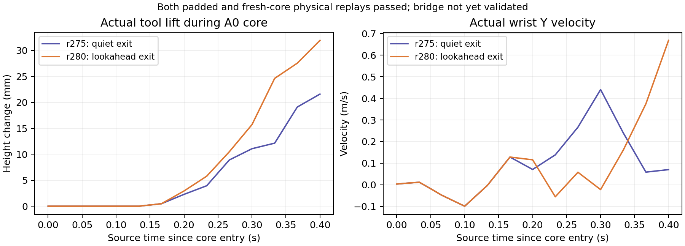

# 双手 Anchor 出口与桥段修复（2026-10-11）

## 目标与当前状态

保持 `oracle → local padded Anchor → exported core → cuRobo RELAXED → continuous PhysX`。
本轮处理 Brush `(brush, eraser, plate)` / `20231103_057` 的双手版本：右手握 eraser，左手握住桌面上的 plate，没有 fixture。源时钟为 110 帧 / 30 fps，完整任务预算 **3.666667 s**。

已确认：A0 的 padded rollout `[14,38)` 与重新从真实可达入口执行的 core `[20,32)` 均通过。r294 的双手 bridge 已通过原 nominal 时间、source 入口和完整规划几何检查，真实执行至帧 37；左手拇指脱离盘子，任务在此停止。尚未确认：完整物理 bridge、后续 A1/A2、完整任务。

## 找到的原因与修复

### 1. 局部有效的抓取出口没有给下一次交互留下可连接边界

旧的 quiet-exit 方案只拟合 A0 自身，末端速度较小。后续 `[32,39)` 仅有 0.233333 s，下一交互位置、姿态和碰撞空间共同限制连接。静态 peer 的边界搜索失败只说明这组条件下搜索未成功，不能证明物理不可达。

修复：从已记录的真实抓取建立点之后，联合拟合 A0 的尾段出口与下一 oracle Anchor 的入口，保持两段各自的时间预算与原有物体边界条件，保留手指命令。候选重新执行 padded rollout 与 exported core 后才算有效。局部验收同时记录真实出口到下一边界的 nominal 可达性；这项检查不等于碰撞或物理验证。

| 实测量 | r275 旧出口 | r280 联合出口 |
|---|---:|---:|
| padded / fresh core | 通过 / 通过 | 通过 / 通过 |
| core 内工具上升 | 21.591 mm | 31.938 mm |
| 出口 wrist Y 速度 | 0.070309 m/s | 0.668412 m/s |
| source-time stretching | 无 | 无 |

工具位移与 wrist 位移还受手物相对变换及 wrist 旋转影响，不用单一轴的速度证明不可达。

### 2. 碰撞预测距离被当成实体占据体积

原碰撞导出用 `contactOffset` 膨胀 native convex pieces。这会把预测接触范围当成实体占据范围，使真实出口在规划器中出现 tool/plate 初态碰撞。

修复：保留 native convex decomposition；占据几何使用非负 `restOffset`，把 `contactOffset` 单独记录。当前 rest offset 为零，contact offset 约 1.3625 mm。**模拟器碰撞参数、摩擦、动力学没有改动**。r281 使用与 r280 完全相同的已验证命令和实测出口后，初态碰撞拒绝消失，进入下一入口搜索。

PhysX 的 `contactOffset` 决定提前生成接触的距离，`restOffset` 决定平衡时的表面间距：[官方说明](https://nvidia-omniverse.github.io/PhysX/physx/5.1.2/docs/AdvancedCollisionDetection.html)。这项修复没有取消 RELAXED 中的实际 tool/plate 非预期接触检查。

XHand 的 CollisionAPI 在 Xform 父节点，Mesh 是其子节点。修正了 peer collider 的归属和坐标变换；当前 SDK 仍不能直接导出这些子 Mesh 的 native cooking 结果，使用实际 authored collision mesh 的完整 convex hull，并明确记录 native export 失败。不能把这个 fallback 描述成已完成 native hand cooking。

### 3. 两只手的终点与路径需要按同一时间协调

静止左手的入口搜索仍失败。新边界优化同时选择右手入口和左手沿桌面的平移；冻结两侧 grasp/fingers，左手保持高度与朝向。r282 找到满足原物体边界、速度/加速度预算和终点碰撞约束的候选：左手桌面平移 `[-26.779, +20.235, 0] mm`，约 33.56 mm。

r282 尚未物理执行：随后单独生成左手路径时仍把右手视为静态障碍，重新引入了独立规划限制，时间拟合被拒绝。r283 修复组件规划后，左手路径生成成功，随后右手在 nominal 时间拟合时被拒绝，仍未执行桥段。

修复：每只手的 cuRobo 路径作为协调运动的候选；组件候选阶段不使用另一只正在移动的手与 payload 的静态位置。生成后恢复全部 peer/payload 碰撞，按同一 physics clock 检查两条完整路径。真实几何相交则拒绝；保守 sphere overlap 需要完整 mesh 确认。最终实际执行仍保留原有 native contact、grasp retention 和状态检查。规划中的 pose override 只用于碰撞预测，未赋值给模拟器。

### 4. 同一边界在两个接口中采用了不同的速度换算

r283 的右手拒绝点为 `No fixed-time boundary trajectory in coordinate 3`。边界优化把空间 angular velocity 转到 ZYX 参数时使用 1e-5 s 有限差分，规划执行使用 1e-4 s；反向转换又引入一次有限差分。候选贴着离散加速度包络时，这些差异改变了可行边界。另外 cuRobo float32 原始路径会把重新写入的精确边界再次舍入。

修复：边界选择、桥段预检查和路径拟合共用解析 ZYX angular Jacobian；从参数速度还原 world twist 使用同一 Jacobian；路径在写入边界前转为 float64。保持原限值与真实 **120 Hz** physics clock，不增加等待。

一次最小的 nominal 边界复算验证了速度往返误差为 3.33e-16、0.233333 s / 28 ticks 的极限边界拟合通过。它不包含碰撞或物理执行，不能替代 r284。第一次手工诊断误用了 240 Hz，已排除为验收证据。

r284 在 Hopper 进一步确认：两侧 cuRobo 路径均通过固定时间拟合。恢复完整 peer/payload 几何后，同步检查在 tick 1 发现工具/盘沿相交；没有执行这个不安全候选。因此速度接口修复已有运行验证，桥段物理成功仍未成立。

### 5. 出口瞬时无碰撞，不代表按实测速度接管后的第一步安全

r284 的 tick 0 没有几何相交，tick 1 已相交。单独导出的 native convex pieces 查询给出第一步工具/盘沿约 **2.224 mm** 穿入，分离法向约 `[-0.4064, -0.4403, +0.8006]`。三角面查询的 depth 不是可靠的实体最小分离距离，因此保留原三角几何拒绝，同时用单个 convex piece 的实体接触方向和深度计算修正。

修复：将这个预测碰撞反馈到真实 predecessor 的局部合成。分离量由预测穿入、现有 native contact band 和 0.1 mm fitter margin 相加得到，约 **5.049 mm**，没有手工设置 sample 偏移。出口位置和速度仍和下一入口一起求解；固定旧速度再平移的方案在 CPU nominal 检查中被拒绝，因此未消耗 GPU 去执行它。

新联合拟合在原有 0.233333 s 尾段与 0.233333 s 桥段预算内通过。手指命令、scene state 与 PhysX 参数保留。r285 重新执行 padded/core 后通过，工具在 core 内实际上升 **41.355 mm**。初次 Replay/MPC 候选未通过出口条件，随后 24,293 参数的 residual PPO 在第 5 轮产生的采样控制通过 fresh padded 和 exported core。这里验证的是导出的控制轨迹，没有声称整个随机策略都已成功。桥段尚未执行：联合终点求解在小约束残差上停住。

几何反馈明确标注 `physical_contact_evidence=false` / `collision_physically_executed=false`。它是已保存 cuRobo 候选的预测碰撞，不能伪装成实际接触、实际物理入口或成功任务。

为避免重复消耗时间，当有合法的已抓取桌面支持手可协同时，尝试一个静态 peer seed 后进入联合求解；其他路径仍保留既有 seed budget。

### 6. 可行边界与 source-score 最优边界不应混为一件事

r285 联合求解多次耗尽迭代后仍有小残差。旧实现只验收最后迭代，继续最小化 source score 也可能丢失中间可行解。变量包含米、弧度、速度，旧变量尺度也不一致。

修复：按原时间、速度和物体容差归一化求解变量；任一迭代满足原约束即保留，不继续追逐 reference 最优值。若仍失败，围绕该候选做最小改动的约束恢复，并记录每条时间、物体和碰撞残差。碰撞验收仍要求 0.1 mm clearance；恢复阶段的 0.01 mm 数值余量只增加保守性。r286 冻结已通过的 A0 控制。第一个 seed 已得到可行终点，两侧 cuRobo 路径均完成时间拟合。同步几何检查前 13 ticks 没有实体相交；tick 14 出现手与手、工具与另一只手的相交，未执行桥段。边界残差修复因此已有运行验证。

### 7. 独立可行路径还需要联合调整中段

r286 表明，两个终点同时可行且两条路径各自可行，仍不能保证同步运动没有碰撞。新增联合拟合复用原固定时间 collision fitter，将两只 wrist 放在同一个优化变量中。r287/r288 先冻结初末状态、初末速度和手指命令，只调整中段；r289 起保留真实初态/初速，允许未验证的 canonical 终态一起拟合。每一步预测都会更新另一只手和其 payload；最终仍用完整实际碰撞 mesh 重新确认，实际 PhysX 再验收。未改 source clock、原物体边界或模拟器参数。

### 8. 固定边界的球体重叠需要核对完整实体

r287 联合拟合把最大 sphere overlap 从 34.833 mm 降至 19.105 mm，随后因固定 tick 27 的 4.321 mm overlap 无法继续收敛而退出，没有执行桥段。CPU FCL 对保存的完整碰撞 mesh 做了一次定位：tick 14 确有三对相交，tick 0、1、27、28 没有相交。这是规划几何证据，不是物理成功证据。

旧覆盖细化把所有路径点对着同一个 peer 位置检查。修复让每个覆盖检查样本使用同一时刻的另一只手及 payload；只用经完整 mesh 确认安全的固定配置细化 full-surface spheres，包含独立建模的 attached object。真实相交、source time、动力学和最终完整 mesh 检查都保留。r288 复用同一 A0，固定样本 0、1、27、28 的联合 clearance 分别变为 0.990、0.564、0.206、0.836 mm，全为正值。完整 hand/body surfaces 保留；右/左 hand cover 数量分别为 154 / 597。覆盖误报修复得到运行验证。中段联合拟合仍失败，未执行 bridge。

### 9. 路线与尚未物理验证的 canonical 入口一起求解

只锁定一次 endpoint search 给出的未验证目标，仍可能把联合中段拟合限制在一个不可用候选中。r289 复用现有 fixed-time fitter，允许入口位置和速度与路线一起调整，但两侧物体入口必须仍在原 oracle 条件内；最终只导出一个 canonical 入口，真实 PhysX 接管才决定它是否可达。已有物理 Anchor 的实际出口、起步速度、手指命令、支持手法向/角度条件和时间预算都保留。非线性 fallback 也保留同一组支持坐标约束，避免 fallback 丢失 table-support 条件。

### 10. 把合法自由度放回路线优化，减少重复物理状态读取

r289 在非线性碰撞拟合中耗尽 20 分钟，调度记录 `Exit_status=-29`。没有进入 bridge 物理执行，不能将其解释为路径物理不可达。旧查询在每个假设下重复读取同一实测 grasp transform、native wrist state 和 collider transform。

r290 仅在 PhysX 暂停的规划阶段缓存这个实际 predecessor，退出规划前清理。缓存与实时几何的 clearance 差异必须小于 1 μm，第一侧实测差异为零。新增每次非线性迭代的残差、查询时间和候选保存；一旦满足原碰撞、时间和 source 条件就停止优化，进入真实执行。移除 fixed-entry 变量对应的重复等式行，避免 scipy 消去固定变量后留下 `0=0` 的约束。一次最小 nominal 检查确认真实初始两点、被保留坐标、时间及动力学限制不变；这不构成 PhysX 成功证据。

旧支持手约束还冻结了桌面 yaw。现在保持桌面法向坐标与 tilt，同时允许路线优化选择平面内 yaw。独立 CPU 几何诊断的 yaw 范围由原 120 Hz / 0.233333 s 离散角加速度预算计算：±0.189583 rad。负向 yaw 候选在原 nominal 限值和联合 source 条件内移除了手与手相交，但仍有工具与支持手相交。它只证明该自由度合法且有用，没有证明 bridge 成功；运行时不使用手写 yaw 曲线或 sample 特例。

### 11. 同几何批量距离查询与允许搜索暂时不可行

r290 三次非线性迭代的 clearance 残差都为 −43.697 mm，第三次累计 108.005 s，其中距离查询占 105.069 s。记录候选后主动结束，避免继续耗尽作业。缓存只消除了重复物理状态读取；逐点碰撞体上传和 peer 差分仍是瓶颈。

r291 用同一 cuRobo world field 和 full-surface covers 批量查询所有 physics samples。peer 几何保持在真实 acquired pose，把查询 sphere 转到对应 peer 的 acquired 坐标，直接对两侧 wrist 求导。先核对初点、中点和终点的旧/新距离，差异超过 10 μm 则拒绝。仅变换规划查询，不改变 PhysX state。

非线性优化复用 elastic SCP 的碰撞残差惩罚，搜索中允许临时相交，最终 clearance、完整 mesh、nominal dynamics 和实际物理检查全部保留。原来硬碰撞线性化在碰撞 seed 上可能没有合法方向，三次原地迭代提供了这个失败模式的证据。还移除了额外的 `0.98²` oracle 优化边界，恢复原 `1.0` 联合条件；实际 5 cm / 30° 验收没有放宽。它是否解决物理 bridge，以本轮实际执行结果为准。

r291 的变换提前转为 float32，距离核对差异达到 27.120 μm，被检查拒绝。r292 把 FK / 坐标变换保留为 double，只在 ESDF 查询处转为 float32，最大差异降至 **0.330 μm**。在实际保存的查询中，平均每条路径耗时从 r290 的 **4.913 s** 降至 r292 的 **0.0403 s**，约 **122 倍**；完整表面与源时间保留。这是求解接口效率证据，不是物理成功。

r292 非线性拟合在 9.95 s 内结束；碰撞残差为 −1.046 mm，但 source 条件为 −1.516、nominal dynamics ratio 为 1.01269，故严格拒绝，bridge 未执行。没有用降低物体精度或提高 dynamics 限值接受这个候选。

### 12. 直接参数化合法运动，分别约束两个物体入口

针对 r292 的 LSQ 求解失败，r293 把实际起步两点和支持手 height/tilt 直接固定在参数化中，仅优化其 null-space 内的合法运动，不再用大量等式要求优化器事后保持这些坐标。两侧 oracle 条件分别作为约束，替代取两者 `min` 的不光滑标量。整体缩放目标函数，保留碰撞惩罚与路线目标的原比例，避免巨大初始 QP 步。

不可改变的 nominal dynamics 行先按原 `1.0001` 数值验收检查，再从优化变量系统移除。最终仍完整复算原 velocity/acceleration、两侧 source 条件、collision、手指与 PhysX 检查。一个最小 nominal 检查验证真实初始两点、支持坐标和两个独立入口条件均保留；r293 的实际结果另行记录。

r293 的 nominal ratio 为 1.000000000001、支持坐标误差为零；最终候选仍距原 0.1 mm clearance 余量差 0.096487 mm，source 残差 −9.338e-6，未接受。r294 围绕该候选做同一约束的最小改动恢复，不再拉回旧路线或旧末速。恢复三次迭代后，clearance 为 0.099998 mm、source 残差 −1.566e-9、nominal ratio 为 1.000000000018；总求解 11.11 s。按原数值误差阈值通过后，才进入真实 PhysX。

### 13. 真实失败定位到支持手的动态抓取

r294 在连续执行到源帧 **37 / 110** 时停止，actual duration **1.233333 s**，segment 内及 segment 间没有 reset。原 bridge `[32,39)` 的前 5 个 source frames 已真实执行，完整 bridge 未通过。

第一处失败为左手 native thumb contact 消失，非拇指仍有接触。左侧 hand/object 相对位置误差 8.293 mm、旋转误差 0.04618 rad；右侧仍保留接触，相对位置误差 2.269 mm、旋转误差 0.07404 rad。没有先触发 tool/plate 非预期接触拒绝。不是用目标动画代替实际执行；该次 actual trace 和本地视频保留。

### 14. 桌面支撑不能删除 payload 的平面惯性

检查执行模型发现明确漏项：`supported_object` 原先完全排除 payload 的质量和惯性，只保留 hand dynamics 与实测接触 preload。环境支持 payload 的法向负载，不意味着平面运动和 yaw 没有惯性。

r295 从实际 PhysX hand+object 与 hand-only Newton–Euler 模型的差值计算 payload wrench：保留桌面切向力及绕法向的内禀转矩，扣除由环境供应的法向负载，并保留力作用点的力矩。桌面法向、payload mass/COM/inertia 都来自当前场景，未新增任务名或 sample 参数。起步仍使用原 takeover memory，手指、目标路径、source clock、物理验收保持。这个漏项对本次接触失效的贡献需要以 r295 实测比较判定，尚不预先声称修复成功。

## 实验记录

| 实验 / Hopper job | 修改或冻结项 | 结果 |
|---|---|---|
| r279 / 658571 | 旧 A0；记录候选的时间、物体、碰撞残差 | A0 通过；静态 peer 入口搜索失败 |
| r280 / 658584 | 联合 A0 尾段与下一物体边界 | A0 padded/core 通过；规划初态被 contact-offset 膨胀几何拒绝 |
| r281 / 658596 | 冻结 r280 物理控制；修正 rest/contact 几何语义 | 初态拒绝消失；7 个静态 peer 入口搜索仍失败 |
| r282 / 658609 | 冻结 r280；联合支持手终点 | 联合终点满足约束；单手静态 peer 路径拟合失败，未执行桥段 |
| r283 / 658630 | 冻结 r280；组件候选 + 同步完整几何检查 | 左手路径生成；右手边界速度换算造成 nominal fit 拒绝；未执行桥段 |
| r284 / 658644 | 冻结 r280；共用解析速度换算、精确边界 | 两侧路径时间拟合通过；同步完整几何在 tick 1 拒绝工具/盘沿相交 |
| r285 / 658651 | 将首步实体碰撞反馈并入出口/入口联合拟合 | A0 padded/core 通过，工具上升 41.355 mm；联合终点求解失败，未执行 bridge |
| r286 / 658754 | 冻结 r285 A0；变量尺度归一化、可行即停、约束恢复 | 联合终点和两侧时间拟合通过；前 13 ticks 没有实体相交，tick 14 双手几何相交，未执行 bridge |
| r287 / 658761 | 两条路径联合固定时间拟合 | 固定 tick 27 的粗 sphere overlap 阻止拟合；完整 mesh 复核该步无相交，bridge 未执行 |
| r288 / 658775 | 同步 peer 条件下细化全表面覆盖 | 四个固定配置的 clearance 都转正；中段拟合仍失败，未执行 bridge |
| r289 / 658780 | 保留真实出口；联合拟合单个 canonical 入口与路线 | 非线性优化耗尽 20 min；bridge 未执行 |
| r290 / 658798 | 缓存暂停中的实测几何、释放合法 yaw、移除重复等式、可行即停 | 两侧缓存几何一致；三次原地迭代后主动结束，bridge 未执行 |
| r291 / 658801 | 同几何批量距离/梯度、elastic 碰撞搜索、原 oracle 条件 | 距离核对差 27.120 μm，检查拒绝；bridge 未执行 |
| r292 / 658807 | double 坐标变换；ESDF 处才转 float32 | 距离核对差降至 0.330 μm，查询约快 122 倍；候选仍违反原 source/dynamics，bridge 未执行 |
| r293 / 658809 | 合法运动 null-space、独立两侧 oracle 条件、整体目标缩放 | nominal ratio 转为 1.000；尚有 clearance/source 小残差，未执行 |
| r294 / 658811 | 近可行候选的原约束恢复 | nominal/source/几何通过；首次真实 bridge 执行到帧 37，左拇指失去接触 |
| r295 / 658824 | 桌面负载的切向/yaw 惯性 feedforward | 已提交，interactive H200 排队；实测结果尚未产生 |

所有作业使用 interactive H200 / 20 min。没有修改原来的 5 cm + 30° **联合椭球**物体验收条件，没有增加等待或伸长 source clock，也没有用 GT 中间状态作为物理证据。

## 可复用范围与验证边界

实现读取 schedule、实测 grasp transform、时间预算和碰撞几何；没有 sample 名称或 frame 特例。联合出口、碰撞导出语义和同步 peer 预测可以用于其他相同接口的任务。双手桌面平移只在场景明确声明 table-supported、允许 object/table contact、且另一只手已有真实 grasp 时使用。

当前验证只覆盖这一真实双手场景，尚未声称跨样本实测通过。完整 V0 仍要求后续 Anchor 的 padded/core artifacts、真正连续的 predecessor reachability、初始 RELAXED 不依赖 synthesis context，以及完整任务的实际状态成功。

## 本地实际状态视频

`outputs/oracle_action_types_20261008/r280_bimanual/exported_core/floating_xhand_actual.mp4`

已逐帧解码：32 帧、30 fps、1.066667 s。它是通过的 A0 前缀，**不是完整任务视频**；手和物体来自实际 PhysX 记录。

并排、相同 source clock 的对比视频：
`outputs/oracle_action_types_20261008/anchor_boundary_repair_20261011/a0_quiet_vs_lookahead_actual.mp4`。
同样已逐帧解码 32 帧；左侧 r275，右侧 r280。

最新通过的 A0 实际状态视频：
`outputs/oracle_action_types_20261008/r285_bimanual/exported_core/floating_xhand_actual.mp4`。
同样已解码 32 帧、30 fps、1.066667 s；最后一帧已目视检查。

相同 source clock 的 r280 / r285 实测对比：
`outputs/oracle_action_types_20261008/anchor_boundary_repair_20261011/a0_previous_vs_collision_feedback_actual.mp4`。
已解码 32 帧、30 fps；两侧都只是通过的 A0 前缀。

首次包含真实 bridge 执行的本地视频：
`outputs/oracle_action_types_20261008/r294_bimanual/exported_core/floating_xhand_actual.mp4`。
已逐帧解码 37 帧、30 fps、1.233333 s，并检查最后一帧。只到帧 37 的失败前缀，不是完整 3.666667 s 任务视频。
