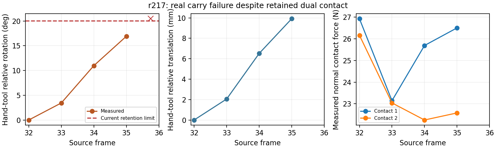

# Lift failure investigation — 2026-10-09

## Latest correction — 2026-10-10

**A complete new brush rollout has not passed.** r221's local core fit moves
Replay failure from frame 44 to frame 55, where grasp retention fails.
Local MPC/PPO and fresh Replay still fail. The lift reward is present, and
the first grasp has actual lifting evidence; this does not complete the task.

A more fundamental scene omission was found while the next job was queued.
In the source contact sheet, the left hand supports the plate. The earlier
EgoEngine implementation constructs both left and right hands; this pipeline
constructs only the right hand. r220's plate moves 140.17 mm by frame 39, while
the source plate moves 1.40 mm. Twenty-five native tool/target contact steps
occur during the nominally collision-free carry [32,39). The triangle checks
did not reject the native contact that pushed the free plate. Imported
dynamic collision decomposition and closed-loop pose/grasp deviations are
possible contributors; the present data does not uniquely attribute them.

This qualifies the older r218 result: its grasp/carry prefix passed the then
implemented gates, but it is **not proof of contact-free transport**. Its
actual-state video remains useful failure evidence, not a successful full task.

The shared right-hand scene now explicitly supports uncontrolled environment
roles with fixtures. `fixed_environment_roles` is a generic scene input; the
single-right-hand configuration declares `target`. The target is fixed only
at task initialization, with triangle collision matching the planner's mesh.
There is no target reference replay or intermediate state assignment. The
manipulated tool remains dynamic. This is an explicit substitute for the
omitted supporting hand, not a claim to reproduce bimanual contact dynamics.

Native tool/target contact now rejects RELAXED transport, including explicit
outgoing-bridge context in local Replay/MPC/PPO. Actual Anchor interactions
still allow the required contact. Export also preserves the actual Anchor's
carried-object feedforward flag; previously a string-only handoff field lost
that flag before the fresh final rollout. r222 reacquired a valid A0 under the fixture scene (both padded and
exported-core checks passed), but carry planning failed. r223 removed an
impossible extra collision margin on fixed physical boundaries; r224 solved
the nonlinear fit to a normalized source-boundary residual of -5.01e-7 but
rejected that numerical residual. r225 accepts only that solver-level finite
precision (1e-6 normalized residual); the physical C.4 gate is unchanged.
The resulting 0.233333 s command is nominally feasible, but actual native
tool/target contact rejects execution at frame 33. No complete task passed.

## Question and acceptance

The observed brush tool moved sideways but did not leave the table. The goal
remains a complete actual PhysX rollout: static oracle schedule, local padded
and exported-core Anchors, cuRobo only for RELAXED intervals, original source
duration, no robot/object resets between segments. Contact alone is not task
success. Existing diversity remains downstream of a successful V0 rollout.

## What the evidence establishes

Lifting reward was already enabled. The shared TACO objective is Appendix
C.3 + C.7 + C.8; C.8 uses measured tool height, with scale 10/m. Training
contact bonus is 2. Evaluation remains object tracking only. These numerical
scales are shared engineering choices, not claimed exact paper parameters.

The r203 diagnostic physically reexecuted the initial cuRobo predecessor and
r201 brush acquisition to frame 26. In two separate physical trials it then
executed either the original continuation or a vertical wrist command with
unchanged finger targets. Both fit the same frame-26-to-32 source budget.
Neither branch assigns an intermediate state.

| Run / branch | Actual wrist rise | Actual tool rise | End dual contact |
|---|---:|---:|---|
| r203 original | 10.44 mm | 1.75 mm | yes |
| r203 vertical, same grip | 20.28 mm | 4.10 mm | yes |
| r204 explicit material, original | 8.53 mm | 0.13 mm | yes |
| r204 explicit material, vertical | 17.46 mm | 0.67 mm | yes |

The tool weighs 1.4715 N in this simulation. The vertical trial's measured
hand-to-tool upward force is intermittent and commonly below that weight;
some samples apply downward force. This explains why touching and lateral
movement did not imply load-bearing grasp. The vertical command experiment
also rules out absence of an upward wrist command as the sole explanation.

Normal contact force is not the full support force. The diagnostic includes
the separately measured friction force via the [Isaac Sim contact API](https://docs.isaacsim.omniverse.nvidia.com/5.1.0/py/source/extensions/isaacsim.core.prims/docs/index.html).
The six frame-boundary samples are an attribution diagnostic, not a continuous
force-closure proof or a new acceptance gate.

## Repairs and their actual outcomes

1. **Robot grasp reference:** transporting the fitted local XHand grasp by
   source tool motion preserves its grasp-frame geometry after closure. This
   replaces a constant human-wrist correction whose grasp frame changed.
   r202 still failed all three first Anchors, so this is not presented as a
   demonstrated physical solution.
2. **Explicit hand/tool friction material:** imported XHand colliders and the
   tool had no physics material binding. Prior EgoEngine reproduction used
   static/dynamic friction 1.0. The shared configuration now binds that value
   to unbound hand/tool colliders, including URDF geometry under `/colliders`
   outside the articulation root; authored materials and table settings stay
   intact. r204 verified all 20 bindings. The same old commands still slipped,
   so friction alone did not solve the grasp.
3. **Gravity moment:** during vertical movement the wrist developed about
   7–8 degrees of rotation error. The actual hand is 1.122385 kg; measured
   compensation moment is about 0.27–0.31 N m. Translation-only weight
   compensation leaves this moment uncompensated. r206 applied the existing
   measured-moment controller variant, but the old commands lost dual contact.
   Changing the controller requires fresh local synthesis; the old learned
   grasp cannot be used as proof under the new controller.
4. **Accurate PPO artifacts:** `baseline.npz` now records the actual compiled
   zero-residual reference. A different input seed is kept separately as
   `proposal_baseline.npz`. This repairs diagnostic provenance, not physics.
5. **Bridge reuse after configuration changes:** after executing a new valid
   initial bridge, the end-to-end loop replaces a rejected older cache with
   that newly executed bridge. This avoids repeatedly replanning an already
   observed valid prefix while preserving fresh physical execution.
6. **Loaded finger-drive tracking:** the old stiffness/damping was 5/0.5;
   actual loaded finger displacement was 0.03–0.075 rad against a grasp fit
   with 0.5 mm geometric preload. The common configuration now uses 50/1.0,
   preserving the existing 3 N m effort ceiling. Initialization and all fresh
   initial-state trials apply the same configuration. r208 changed these
   gains relative to r207 and freshly synthesized the interactions; brush A0
   passed both padded playback and a separate exported-core playback from a
   physically reexecuted predecessor. No source/action-specific branch is used.

r205 ran the complete pipeline entry point for brush: its initial RELAXED
bridge physically passed; Replay/MPC/PPO and fresh local playback failed A0.
Fresh local playback reached the core exit with about 4.87 mm tool rise, but
carried-tool/table clearance remained -0.30 mm. No accepted Anchor or full
trajectory was exported. Elapsed time was 540.12 s.

## New physical result: brush A0 passes

r207 with explicit material and gravity moment but the old finger gains failed
all three first Anchors. r208 with the loaded finger gains passed brush A0:

| Measured quantity | Result |
|---|---:|
| Padded synthesis interval | [14, 38), 0.8 s |
| Exported core interval | [20, 32), 0.4 s |
| Padded rollout success | true |
| Fresh physically reached core replay success | true |
| Actual tool height gain over the core | 18.869 mm |
| Core-exit tool/table clearance | 15.111 mm |
| Core-exit contact | thumb and middle finger |
| State resets inside either validation rollout | 0 |

The core starts at a freshly executed initial cuRobo predecessor, not an
assigned robot/object pose. The final tool is above the table and remains in
opposition contact. This is evidence of a local load-bearing grasp. It does
not establish full task success or grasp transfer to the other objects.
The pour and hit first Anchors still failed in r208.

The largest recorded hand-speed ratio is 0.307 of the URDF velocity limits.
One compliant joint stop overshot by 0.000719 rad; this report does not claim
mathematically exact simulator joint bounds. No new torque gate was added.

## Remaining full-pipeline failure and repair

The brush end-to-end entry point executed its initial bridge and A0, then
rejected the carry bridge [32, 39), whose original budget is 7/30 = 0.233333 s.
The fixed-budget fit reported acceleration ratio 14.696; path-speed fitting
reported an incompatible moving boundary; the boundary-constrained fit
collided at tick 2. These are planning failures, not evidence that the newly
validated grasp replay failed.

A concrete timing mismatch was found: cuRobo optimized on its default
32-knot clock with 1/30 s between knots (1.033333 s), then the executor fitted
that path to the 0.233333 s source bridge. For moving boundaries, compression
changes the physical start/end derivatives. The carry optimizer now uses
`min(32, physics_ticks + 1)` knots and `source_duration / (knots - 1)` per
step, with the physics step as the minimum trajectory step. The free-motion
backend is unchanged. Final dynamics,
geometry checks and fresh continuous PhysX validation remain required.
The [cuRobo MotionGen configuration](https://curobo.org/_api/curobo.wrap.reacher.motion_gen.html)
documents fixed `trajopt_dt` for non-static starts.

The VPN recovered and this repair has since been executed on Hopper. r209
exposed cuRobo's requirement that trajectory dt must not be below interpolation
dt; reducing the number of knots fixed that constructor error without adding
source time. r210 then reproduced the collision rejection below.

### Bridge attribution after reconnection

| Run | Observed outcome | Cause / reusable response |
|---|---|---|
| r210 | Nominal boundary fit rejected by collision spheres | At tick 2 the coarse carried-tool sphere overlaps the plate by 1.324 mm, while full triangle meshes have 5.246 mm separation. Refine conservative surface coverage against all mesh-safe fitted poses. Keep every surface and obstacle. |
| r211 | The 0.233333 s bridge executes with frozen fingers and retained dual contact; next source boundary fails | Actual tool error is 92.37 mm / 30.50 deg. The proposed boundary was already 38.04 mm / 15.23 deg away from the source: locking the human terminal wrist velocity consumed the reachable yaw envelope. This was not a successful handoff. |
| r212 | Source-conditioned pose and a robot terminal velocity are nominally reachable; fitted path has a real mesh collision | The oracle fixes pose/contact/time, not human wrist velocity. Jointly select one canonical pose/velocity inside the unchanged source-boundary ellipsoid and discrete dynamics envelope. The proposal error is about 2.66 mm / 1.98 deg, but that does not prove path feasibility or physical success. |
| r213 | Collision-aware source-time fit fails to converge | cuRobo's ESDF backward ignores the reduction's gradient unless `return_loss=True`. The distance gradient was being used incorrectly. |
| r214 | Correct gradient has unit translation norm; translation-only collision LP is infeasible | The carried tool intersects the plate at fitted ticks 4–8. Wrist orientation must be part of the collision/time fit, rather than being fixed while only position is changed. |
| r215–216 | All six coordinates are fitted, but the first hard collision linearization is infeasible; elastic iterations reduce penetration to 1.839 mm | Saved constraints independently show nominal dynamics feasible. Use local trust steps and collision penalties only during optimization, with zero final collision slack. |
| r217 | Jointly fitting the still-unvalidated next entry produces a collision-free, fixed-time command path; actual carry fails at frame 35.75 | Contact remains, but measured hand/tool rotation reaches 20.46 deg. Retain this as physical failure. A local repair misleadingly returns an unchanged core because its post-context modifies the bridge and checks retention only at source frames. |
| r218 | Repaired local grasp and actual carry bridge pass; A1 fails at frame 43 | Correct the local repair flow and then use actual bridge-boundary feedback. No gate is relaxed. A1's stable-grasp controller was dropping the carried-object dynamics feedforward used by the incoming bridge. |

The fitter differentiates the same cuRobo surface-distance field through all
six virtual wrist coordinates. It preserves the actual moving entry and the
velocity/acceleration budgets. A physically validated canonical exit stays
fixed; before the next Anchor has a validated entry, its proposed pose and
velocity can be fitted jointly inside the unchanged oracle boundary condition.
This chooses one canonical entry, not a Goal Set. Final collision checks and
real PhysX execution remain authoritative.

### New physical result: grasp followed by a carry bridge

r218 candidate 02 physically executes initial → cuRobo → A0 → cuRobo → A1
entry without resets. The bridge lasts exactly 0.233333 s and freezes the
finger commands. At frame 39 the measured tool boundary error is 19.577 mm /
16.542 deg, inside the same combined 5 cm / 30 deg oracle condition. Recorded
hand/tool relative rotation stays below 10.36 deg; the runtime checks retention
and actual mesh collision at every physics step. Wrist tracking error remains
21.444 mm / 14.118 deg and is reported separately from task-boundary acceptance.
This is a successful bridge, not a completed brush interaction or full task.

The local repair now preserves the already physically executed retarget core,
rather than rebuilding the failed raw acquisition. Replay, MPC and PPO use
the actual outgoing bridge commands as context; they no longer substitute a
stationary hold or a differently joined wrist path. Local context uses the
same per-physics-step retention check as runtime. The accepted r218 A0 differs
from the old reference by at most 1.016 mm in wrist position and 0.026665 rad in
finger drive. It has freshly validated padded/core artifacts. Source timing,
contact and tracking tolerances were not changed.

The r217 rotation is largely along the nominal two-point pinch axis (axis
alignment 0.889 at frame 35), despite 23–27 N normal contact. This suggests
rotational grasp compliance; nominal contact targets are not measured contact
positions and do not establish force closure. The attached figure plots the
actual recorded rotation, translation and normal forces.

### Next interaction's execution repair

At A1 entry, r218 has a real predecessor and an accepted source boundary. Its
Replay fails object fidelity at frame 43; MPC/PPO and fresh Replay also fail.
The bridge's measured rigid-grasp dynamics feedforward is switched off when
the stable-grasp Anchor starts, leaving only hand gravity compensation and a
short fading handoff bias. The new local synthesis path retains carried-object
dynamics compensation for stable-grasp Anchors. Replay, MPC, PPO, predecessor
reexecution and final artifact execution use the same recorded interface.
Previously validated artifacts retain their recorded control semantics.
This addresses an observed execution discontinuity, but does not solve A1:
r219 Replay reaches frame 45 instead of 43; fresh local refinement still fails
retention. r220 additionally prefers the next interaction's entry velocity
when selecting the unvalidated canonical boundary. Its carry reaches a valid
A1 entry, but A1 fails object fidelity at frame 44.

r220 keeps dual contact throughout frames 39–44. Tool position error grows
from 20.43 mm to 50.37 mm while wrist target tracking error decreases toward
failure. The command retains positive lateral velocity as the source reverses.
The object-relative handoff uses one Hermite duration for both position and
rotation; the slower rotation offset extends the position/velocity correction
to about 0.34 s. This is a specific command-handoff problem, not evidence of a
missing lift reward or PPO model capacity.

r221 replaces that stable-grasp Replay proposal with a fit of the **local core**
source object poses through the measured hand/object transform. Measured wrist
pose and velocity are the initial boundary; the existing wrench takeover
preserves the prior controller response and finger preload. The fit uses the
unchanged 1.5 s core budget and shared nominal velocity/acceleration bounds.
An offline rigid-grasp prediction satisfies the source condition, but is only
an initialization check; it does not establish physical interaction success.
Fresh PhysX Replay, local refinement when necessary, and uninterrupted runtime
remain the acceptance tests.

Two observed redundant loops were removed: a pre-command planning failure
does not rerun unchanged successful grasp synthesis, and carry-context
resynthesis that returns identical core commands and actual exit reports no
progress. The valid local Anchor remains available for the next experiment.
These guards prevent wasted allocations; they do not relax physical gates.

The validated A0 commands can warm-start the next end-to-end run; every
boundary and final rollout must still be physically reexecuted. Repeating
unconditioned grasp synthesis for the same planner rejection is not new
interaction evidence.

## Scope and artifacts

All changes depend on local Anchor data, object/hand geometry, actual measured
mass/COM/contact, or cache provenance. There is no action-name/source-ID branch,
no object mass reduction, no source-clock stretch and no relaxed human-path
fidelity gate. The shared default configuration now matches the exact loaded
finger/gravity/material variant physically used by r208. That is a reusable
mechanism with one demonstrated local success; multi-object transfer remains
unproven.

At this report revision, a new complete multi-type rollout has not passed.
The brush initial approach and A0 are physically validated. The carry
has not passed the newly added native contact check; A1 remains unvalidated. Completed single-source jobs reported about 6 GB resident memory.
r221 revealed that the submitted 4 CPU / 75 GB override still resulted in a
12 CPU / 225 GB scheduler request. Correcting the queued resource request
produced a verified 4 CPU / 75 GB / H200 / 20 min request; the PBS defaults
now use these values too. A new submission still expands to 12 CPU / 225 GB
on the server, so the expansion is not solely a script-default issue: verify
the scheduler's actual resource list and correct the queued request. No
running job was cancelled or migrated.
The files in `evidence/oracle_action_types_20261008/` contain machine-readable
attribution results, failed full-pipeline reports, the original r208 A0 report
and `r208_lift_summary.json`. The artifact writer also now distinguishes
`core_rollout_complete` from the separately validated padded interval.

Local core video:

`/Users/apple/Desktop/semantic verifier/multipath/outputs/oracle_action_types_20261008/r208_brush/measured_core_video/floating_xhand_actual.mp4`

It contains 12 frames at 30 fps (0.4 s), rendered from recorded actual PhysX
wrist, hand joints and object poses. Exact URDF visual FK reconstructs the
hand meshes; an earlier same-scene recording supplies visual geometry and
static background only. The renderer runs no physics and uses no reference
motion. It is a local A0 core clip, not a complete task video.

## Bimanual extension requested — 2026-10-10

The source left hand supports the plate. The new optional two-hand backend
imports the existing left SPIDER XHand, applies the same wrench/finger
controller as the right hand, and steps both on one PhysX source clock.
The target is dynamic in `floating_xhand_bimanual.json`; no fixture, source
object animation or intermediate object assignment is used. Native measured
left wrist/q/dq/contact/drive state is included in every actual trace record.

`prepare_supporting_anchors.py` adds only the left padded local retargets to
the existing right proposals. The hand/object assignment and contact modes
are static oracle inputs. Finger kinematics, surface grasp fitting and local
contact linearization now accept either real XHand side. The algorithm has
no action-name or sequence-name branch. Numeric controller/reward settings
remain shared. The brush bimanual oracle is a manually reviewed data input,
not a task-specific controller patch.

The first joint experiment uses the passed right A0 commands only as a seed.
It physically executes a left cuRobo approach plus local padding, alongside
the right actual predecessor, then requires two checks: joint padded replay
and separate exported-core replay from a physically reexecuted entry. Each
trial initializes once before time zero and uses no segment-boundary reset.
This experiment does not establish the complete bimanual task.

r226 completed all three local left retargets, then exposed a startup bug:
importing the second robot after the first PhysX reset invalidated existing
articulation handles (`NoneType.link_names`). Both hands now import before
the first reset. r227 then physically executed both hands through frame 32.
Right A0 passed; left had about 1.50 N index contact, but no thumb opposition,
so the joint padded Anchor failed its unchanged exit-contact gate. The target
drift was 0.213 mm at that point. This was not a successful dual grasp.

r228 reused the existing floating MPC/PPO solver through a second-hand view
of the same shared scene. Every candidate executes the right controller too,
while optimization acts on the left wrist/fingers. MPC did not solve it. A
24,293-parameter residual PPO model found accepted sampled controls at update
20. Fresh initial-state execution passed both hands over the complete padded
window [14,38), with no reset within the rollout. Exported-core replay failed
left contact at frame 32; this result is reported separately, not as a passed
bimanual Anchor.

Two export-interface errors were identified: the acquired core entry reused
the old baseline's wrist takeover profile after PPO changed the trajectory;
and CORE playback generated a new takeover instead of slicing the successful
padded controller program. The profile is now compiled from the selected
commands and the measured entry, and CORE preserves the source-indexed
commands plus wrench inputs. `joint_commands.npz` now includes these control
inputs. This is a reusable command/export fix, with no pose assignment or
source-time change. r229 reuses the learned commands for a direct fresh
padded/core physical verification. It again passed padded Replay but failed
left core contact at frame 32. Its log lacks `core_controller_program`: the
job loaded the preceding exporter before the atomic script update completed.
A measured comparison showed exactly identical left entry state/targets at
frame 20; the newly generated core takeover then changed physical motion.
r230 (PBS 657071) verified the already-uploaded program-slicing repair,
without more PPO. Both hard gates passed: fresh joint padded execution
[14,38) and exported-core execution [20,32) from a physically reached entry.
At core exit, both hands had measured thumb AND non-thumb opposition
contact. The padded run retained both contacts through frame 38. The dynamic
plate was not held by a fixture. Each validation trial executed from the task
initial state with zero state resets inside that trial.

The core entry is at 0.666667 s, its exit at 1.066667 s, and the padded run
ends at 1.266667 s. The core still occupies its original 12 / 30 = 0.4 s
source budget. Actual eraser height increased 5.188 mm at core exit and
16.457 mm at padded exit relative to the initial state. Plate translation was
0.885 mm at core exit and 9.165 mm at padded exit; this is measured motion,
not evidence that the plate is perfectly fixed or that later interactions
will succeed.

The PPO search used the same shared local reward/controller parameters,
a 24,293-parameter model and 211.303 s of training. r230 is an independent
fresh physics validation of its compiled controls, not another training run.
The export repair preserves controller inputs across padding removal. It
is a reusable fix to the control-program interface; physical evidence is
currently limited to this joint Anchor, and transfer remains unverified.

Machine-readable evidence: `evidence/oracle_action_types_20261008/r230_bimanual_result.json`.
Local actual-state video (38 frames, 30 fps, 1.266667 s):

`/Users/apple/Desktop/semantic verifier/multipath/outputs/oracle_action_types_20261008/r230_bimanual/padded/floating_xhand_actual.mp4`

Red is the right XHand/eraser; green is the left XHand/plate. Video geometry
comes from recorded actual PhysX mesh transforms. This is the first local
bimanual Anchor, not the complete 110-frame task. Its core entry was acquired
with physical synthesis context; replacing that context with a final RELAXED
bridge and connecting the remaining Anchors still requires validation.
The final report explicitly retains `full_pipeline_success=false` and
`task_success=false`.

The r225 failure diagnostic samples convex-hull tool vertices against the
actual target triangle mesh. At frame 33, planned minimum sampled distance
is 2.422 mm and actual minimum is 0.412 mm. Wrist target error is 2.741 mm;
relative grasp changes 0.877 mm / 2.263 degrees from frame 32. Opposition
contact remains. These unsigned samples do not prove absence of penetration,
but demonstrate why nominal geometric clearance alone is insufficient;
native contact remains a hard transport gate.
